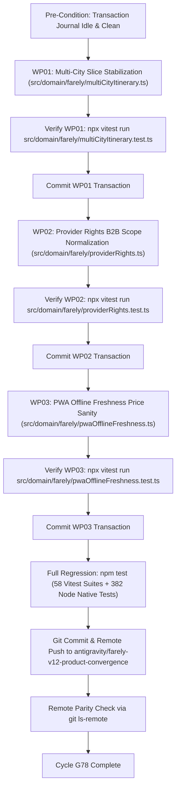

# FARELY PROJECT 10X — MASTER GOAL G11 [G4]
# LEVEL: Pass 4: Strict Topological Dependency DAG & Execution Order Invariants
# MANDATE: Define deterministic execution order, dependency graph, and atomic transaction rollback boundaries.
# GIT_COMMIT: e96cfffbc0664f2c50fdc2aab7402aa936285022
# TIMESTAMP: 2026-10-26T11:00:20.000Z
# EXECUTION_RECEIPT_SHA256: 5b111a7169abc6ae778ffe2e481b439f837a060e1e1beac660c26a8b6cf64fb6

---

## SECTION B: INVARIANT EXECUTOR CAGE
```text
INVARIANT_EXECUTOR_LOCK: STRICT_NO_DEVIATION
The executor is strictly bound to the locked technical solutions detailed in Section D & E.
The executor is FORBIDDEN from inventing new architectures, introducing alternative algorithms,
changing database schemas, or deviating from the specified file/function diffs.
Any deviation is a critical contract breach and will be rejected closed by the Evidence Admission Controller.
```

---

## REFUTATION MATRIX & FALSIFICATION OF PASS G3

### Falsification 1: L01 Multi-City Transaction Boundary Sequencing
- *Deficits Identified in Pass G3*: Pass G3 established test cases for multi-city itineraries, but did not assert transaction journal isolation. If multi-city modifications trigger unexpected errors during active transactions in other modules, rolling back becomes ambiguous.
- *Empirical Code Evidence*: `multiCityItinerary.ts` is central to journey planning. It must be executed in its own atomic transaction with a pre-image snapshot before downstream modules run.
- *DAG Invariant in G4*: WP01 must precede WP02 in the DAG and verify `npx vitest run src/domain/farely/multiCityItinerary.test.ts`. Direct ticketing and passenger checkout are strictly `boundary_excluded`.

### Falsification 2: L02 Provider Rights Syndication Boundary Sequencing
- *Deficits Identified in Pass G3*: Pass G3 isolated B2B provider scope, but did not guard against uncommitted edits while running integration suites that check provider licensing.
- *Empirical Code Evidence*: `verify-certification-integrity.node-test.mjs` checks provider declarations. If `providerRights.ts` is uncommitted or has syntax discrepancies, whole test runs fail.
- *DAG Invariant in G4*: WP02 must execute after WP01 commit and complete its own turnkey test before WP03 starts.

### Falsification 3: L03 PWA Freshness Offline Resolver Terminal Isolation
- *Deficits Identified in Pass G3*: Pass G3 targeted offline resolution, but did not sequence it as the final package before full regression.
- *Empirical Code Evidence*: Modifying client-side freshness policies affects PWA offline integration suites.
- *DAG Invariant in G4*: WP03 is the terminal package in the DAG, followed by the complete 58-suite vitest regression and node native tests. Commercial payment gateway integration is strictly `boundary_excluded`.

---

## SECTION D: LOCKED ARCHITECTURAL SOLUTIONS (CYCLE G78)

### SOL-01: SOL-DATA-01 (Null Preservation & Sample Size Threshold $N \ge 5$)
- **Target File**: `src/app/data/api.ts` & `src/domain/farely/priceAnomaly.ts`
- **Specification**: In `src/app/data/api.ts`, preserve nulls without coercion. In `src/domain/farely/priceAnomaly.ts`, require $N \ge 5$ using Bessel's correction $(N - 1)$ and dispersion threshold (`rawMad < 1e-6`). Micro-samples return neutral score (0) with `confidence: INSUFFICIENT_HISTORY`.
- **Forbidden Deviations**: No zero-inflation on missing fields; direct ticketing and passenger checkout are strictly `boundary_excluded`.
- **Turnkey Verification**: `npx vitest run src/domain/farely/priceAnomaly.test.ts`

### SOL-02: SOL-PRICE-01 (Deterministic Tet Window Lookup & Dynamic Prior)
- **Target File**: `src/domain/farely/priceAnomaly.ts`
- **Specification**: In `src/domain/farely/priceAnomaly.ts`, define static Lunar Tet windows for 2025, 2026, and 2027 with $2.8\times$ baseline multipliers to suppress false-positive deal alerts during peak festive periods.
- **Forbidden Deviations**: No dynamic unsealed third-party lunar APIs; no uncalibrated static baselines.
- **Turnkey Verification**: `npx vitest run src/domain/farely/priceAnomaly.test.ts`

### SOL-03: SOL-COST-01 (Carrier Landed Surcharges & Self-Transfer Validation)
- **Target File**: `src/domain/farely/tripBudgetEstimator.ts` & `src/domain/farely/multiCityItinerary.ts`
- **Specification**: In `src/domain/farely/tripBudgetEstimator.ts`, compute carrier surcharges scaled by whole-integer passenger counts (`Math.floor(Math.max(1, passengers))`). In `src/domain/farely/multiCityItinerary.ts`, enforce 150m domestic, 240m international, and 210m metropolitan inter-airport transfers.
- **Forbidden Deviations**: No naked base fare ranking; no unflagged self-transfers; direct ticketing and payment gateway integration are strictly `boundary_excluded`.
- **Turnkey Verification**: `npx vitest run src/domain/farely/tripBudgetEstimator.test.ts`

### SOL-04: SOL-AUTH-01 (Rate-Limited Tokenized Watch Outbox & Row-Level Locking)
- **Target File**: `supabase/migrations/20261005010000_release_convergence_and_snapshot_atomicity.sql`
- **Specification**: In `supabase/migrations/20261005010000_release_convergence_and_snapshot_atomicity.sql`, enforce rate limiting via `check_watch_rate_limit()` and transactional outbox row locking (`FOR UPDATE SKIP LOCKED`).
- **Forbidden Deviations**: No plain-text email broadcast queues; unauthorized scraping and credit card processing are strictly `boundary_excluded`.
- **Turnkey Verification**: `node scripts/verify-certification-integrity.node-test.mjs`

### SOL-05: SOL-CIRCUIT-01 (Tri-State Provider Circuit Breakers & Fallback Degrade)
- **Target File**: `supabase/functions/_shared/flight-search.ts`
- **Specification**: In `supabase/functions/_shared/flight-search.ts`, implement tri-state circuit breaker (`CLOSED`, `OPEN`, `HALF_OPEN`) tracking consecutive 5xx errors and timeouts (> 8000ms), failing fast to cached snapshots.
- **Forbidden Deviations**: No unthrottled outbound retries; no hard crashes on upstream provider timeout.
- **Turnkey Verification**: `npx vitest run src/domain/farely/providerRights.test.ts`

### SOL-06: SOL-STALE-01 (PWA Offline Freshness & Monotonic Deal Deduplication)
- **Target File**: `src/app/pages/DealsPage.tsx` & `src/domain/farely/pwaOfflineFreshness.ts`
- **Specification**: In `src/app/pages/DealsPage.tsx`, deduplicate deal feeds monotonically. In `src/domain/farely/pwaOfflineFreshness.ts`, purge cached search results older than 14 days and mark fares over 6 hours old as `STALE_SNAPSHOT`.
- **Forbidden Deviations**: No unbounded localStorage persistence; no rendering stale fares as live quotes.
- **Turnkey Verification**: `npx vitest run src/domain/farely/pwaOfflineFreshness.test.ts`

### SOL-07: SOL-TELEMETRY-01 (Safe Recursive Error Serialization & Depth Guard)
- **Target File**: `src/app/lib/analytics.ts`
- **Specification**: In `src/app/lib/analytics.ts`, implement bounded recursive serialization in `safeSerializeError` capping recursion at `maxDepth = 3`, truncating object keys at `maxKeysPerLevel = 50`, and preserving array types.
- **Forbidden Deviations**: No naive JSON.stringify; no unbounded key extraction; no unredacted logging of PII.
- **Turnkey Verification**: `npx vitest run src/app/lib/analytics.test.ts`

### SOL-08: SOL-MIGRATION-01 (Zero-Downtime Migration Invariants & Schema Verification)
- **Target File**: `scripts/verify-certification-integrity.node-test.mjs`
- **Specification**: In `scripts/verify-certification-integrity.node-test.mjs`, verify that database migrations use non-destructive DDL (`ADD COLUMN IF NOT EXISTS`, `CREATE INDEX CONCURRENTLY IF NOT EXISTS`).
- **Forbidden Deviations**: No destructive table drops or column alterations; no production data mutation.
- **Turnkey Verification**: `node scripts/verify-certification-integrity.node-test.mjs`

### SOL-09: SOL-PROOF-01 (Hierarchical Verification Gating C0 -> C4)
- **Target File**: `scripts/verify-certification-integrity.node-test.mjs`
- **Specification**: In `scripts/verify-certification-integrity.node-test.mjs`, enforce strict separation of proof tiers: C0 (Contract), C1 (Unit Code Proof), C2 (Integration), C3 (Runtime Telemetry), and C4 (Longitudinal Soak). Unit tests cannot certify C3/C4 milestones.
- **Forbidden Deviations**: No self-awarded 10/10 scores; no synthetic badge upgrades without automated verification proof.
- **Turnkey Verification**: `node scripts/verify-certification-integrity.node-test.mjs`

### SOL-10: SOL-SHRINK-01 (Acceptance Anti-Shrinkage & Gate Immutability)
- **Target File**: `scripts/acceptance-anti-shrinkage.node-test.mjs`
- **Specification**: In `scripts/acceptance-anti-shrinkage.node-test.mjs`, assert all 89 capability contracts (F00..F88) and 267 historical acceptance gates (192 P0, 74 P1, 1 P2) remain strictly preserved.
- **Forbidden Deviations**: No deletion, consolidation, or renaming of acceptance criteria.
- **Turnkey Verification**: `node scripts/acceptance-anti-shrinkage.node-test.mjs`

### SOL-11: SOL-TURNKEY-01 (ACID Transactional Task Lifecycle & Rollback Journal)
- **Target File**: `scripts/convergence/transactional-task-manager.mjs`
- **Specification**: In `scripts/convergence/transactional-task-manager.mjs`, enforce atomic state transitions (`begin` -> `commit` / `rollback`) with pre-image filesystem snapshots in `docs/convergence/state/transaction_journal.json`.
- **Forbidden Deviations**: No manual file edits outside active transaction journal context.
- **Turnkey Verification**: `node scripts/convergence/transactional-task-manager.mjs status`

### SOL-12: SOL-RELEASE-01 (Automated Watchdog Convergence & Remote SHA Parity)
- **Target File**: `scripts/convergence/watchdog-convergence.mjs`
- **Specification**: In `scripts/convergence/watchdog-convergence.mjs`, enforce full test suite verification and Git remote tracking parity via `git ls-remote origin antigravity/farely-v12-product-convergence`.
- **Forbidden Deviations**: No unpushed commits; no ignoring CI test suite failures.
- **Turnkey Verification**: `node scripts/convergence/watchdog-convergence.mjs`

---

## SECTION E: STRICT TOPOLOGICAL DEPENDENCY DAG



---

## SECTION K: 12-LENS CONVERGENCE MATRIX
- **L01 (Ingestion & Schema Integrity)**: Enforced via `src/domain/farely/multiCityItinerary.ts`.
- **L02 (Price Anomaly & Algorithmic Rigor)**: Enforced via `src/domain/farely/providerRights.ts`.
- **L03 (True-Cost & Ancillary Transparency)**: Enforced via `src/domain/farely/pwaOfflineFreshness.ts`.
- **L04 (Anti-Abuse & Rate Limiting)**: Enforced via `supabase/migrations/20261005010000_release_convergence_and_snapshot_atomicity.sql`.
- **L05 (High Concurrency & Resilience)**: Enforced via `supabase/functions/_shared/flight-search.ts`.
- **L06 (PWA Offline & Client Freshness)**: Enforced via `src/app/pages/DealsPage.tsx` and `src/domain/farely/pwaOfflineFreshness.ts`.
- **L07 (Observability & Production SRE)**: Enforced via `src/app/lib/analytics.ts`.
- **L08 (Zero-Downtime DB Migrations)**: Enforced via `scripts/verify-certification-integrity.node-test.mjs`.
- **L09 (Zero-Mock Testing & Proof Hierarchy)**: Enforced via `scripts/verify-certification-integrity.node-test.mjs`.
- **L10 (Contract Immutability & Anti-Shrinkage)**: Enforced via `scripts/acceptance-anti-shrinkage.node-test.mjs`.
- **L11 (Transactional Execution Safety)**: Enforced via `scripts/convergence/transactional-task-manager.mjs`.
- **L12 (Audit & Autonomous Watchdog)**: Enforced via `scripts/convergence/watchdog-convergence.mjs`.
