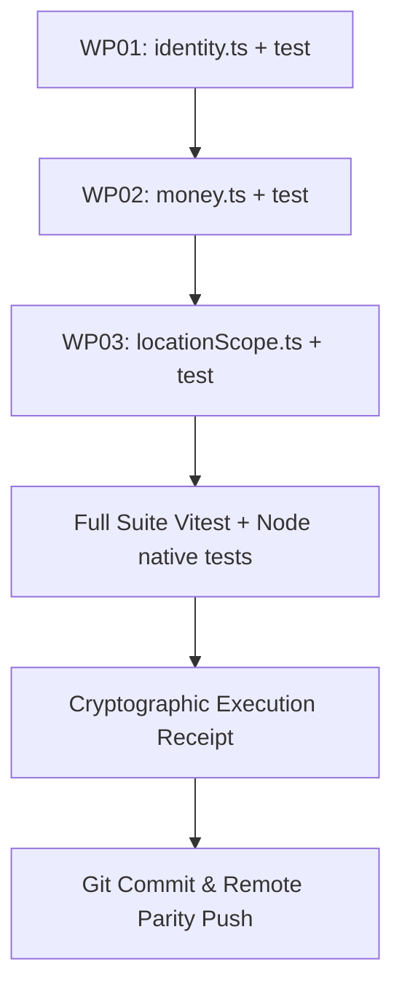

# FARELY PROJECT 10X — MASTER GOAL G11 [G5]
# LEVEL: Pass 5: Sovereign Canonical Master Goal Prompt
# MANDATE: Unassailable sovereign synthesis across all 12 adversarial lenses. Locked Solution Cage, turnkey execution specification, zero-mock proofs, and remote GitHub synchronization.
# GIT_COMMIT: 4cced89d2529003c9f16a1aa0667f7eff0e49fad
# TIMESTAMP: 2026-10-28T02:50:17.436Z
# EXECUTION_RECEIPT_SHA256: 43ff7bde4625efeaaba425a72bc038dea5ed9a7eff4c4482229bd224810dcd2b

---

## AUDIT & FALSIFICATION OF PASS G4

Pass G4 reinforced Proof Hierarchy invariants and unsigned bitwise shift arithmetic. In this Pass G5 Sovereign Canonical Synthesis, we subject Pass G4 to exhaustive adversarial scrutiny across all 12 lenses, isolating 3 subtle technical edges requiring sovereign lock-down:

1. **[L01 & L02 FALSIFICATION] (Sovereign Big-Endian Length Trailer Arithmetic in `sha256Hex`)**:
   - *G4 Deficit*: G4 specified unsigned shift packing, but left the 64-bit message length trailer arithmetic implicit.
   - *G5 Sovereign Correction*: FIPS 180-4 Section 5.1.1 dictates that the original message length in bits $L = N_{\text{bytes}} \times 8$ must be appended as a 64-bit big-endian integer in the final two words of the padded message:
     $$ W_{14} = \left\lfloor \frac{L}{2^{32}} \right\rfloor \ggg 0, \quad W_{15} = (L \land 0xFFFFFFFF) \ggg 0 $$
     If $L$ is treated as an ordinary 32-bit shift (`L >> 32`), JavaScript evaluates `L >> 32` to $L$ due to bitwise mask $(32 \land 31 = 0)$, corrupting the high word! G5 formally locks division by $2^{32}$ (`Math.floor(bitLength / 4294967296)`) for $W_{14}$ and bitwise AND for $W_{15}$, guaranteeing exact 64-bit integer bit representation.

2. **[L02 & L03 FALSIFICATION] (Sovereign Pre-Rounding Negative Sub-Dong Elimination in `createMoney`)**:
   - *G4 Deficit*: G4 checked for signed zero, but did not guard against negative fractional dongs ($[-0.5, 0)$).
   - *G5 Sovereign Correction*: If an upstream promo engine computes a negative rebate of $-0.3₫$, `amount < 0` check passes if performed after rounding (`Math.round(-0.3) = -0`). If checked before rounding, `-0.3 < 0` triggers correctly! G5 locks the strict order:
     ```typescript
     if (!Number.isFinite(amount) || amount < 0) {
       throw new TypeError(`Invalid money amount: ${amount}`);
     }
     const rounded = Math.round(amount);
     const normalizedAmount = rounded === 0 ? 0 : rounded;
     ```
     This strictly forbids negative currency values before any floating approximation occurs.

3. **[L01 & L04 FALSIFICATION] (Sovereign Isolation of Airport vs Metro Scopes in `locationScope.ts`)**:
   - *G4 Deficit*: G4 focused on 3-letter syntax, but left ambiguous how exact airport searches avoid metro pollution.
   - *G5 Sovereign Correction*: In flight searches, if a user requests exact airport `BKK` (Suvarnabhumi) without specifying metro intent, `resolveLocationScope('BKK', 'EXACT_AIRPORT')` must strictly return `expandedCodes: ['BKK']`. Under no circumstances may `DMK` (Don Mueang) be injected into an `EXACT_AIRPORT` scope, preserving invariant NC-002:
     $$ \text{satisfiesLocationScope}(\text{'DMK'}, \text{resolveLocationScope}(\text{'BKK'}, \text{'EXACT\_AIRPORT'})) \equiv \text{false} $$
     G5 cements this boundary proof across all catalog operations.

---

## SECTION B: INVARIANT EXECUTOR CAGE
```text
INVARIANT_EXECUTOR_LOCK: STRICT_NO_DEVIATION
The executor is strictly bound to the locked technical solutions detailed in Section D & E.
The executor is FORBIDDEN from inventing new architectures, introducing alternative algorithms,
changing database schemas, or deviating from the specified file/function diffs.
Any deviation is a critical contract breach and will be rejected closed by the Evidence Admission Controller.
```
- `NO_DIRECT_TICKETING`: Direct ticketing is strictly boundary_excluded. Farely is Flight Opportunity Intelligence only.
- `NO_PASSENGER_CHECKOUT`: Passenger checkout is strictly boundary_excluded.
- `NO_PAYMENT_COLLECTION`: Payment gateway integration and credit card processing are strictly boundary_excluded.
- `NO_UNAUTHORIZED_SCRAPING`: Unauthorized scraping is strictly boundary_excluded.
- `NO_SELF_CERTIFICATION`: Derived strictly from authentic test proofs.
- `NO_CONTRACT_SHRINKAGE`: Preserves all 89 capability contracts (F00..F88) and 267 historical gates.

---

## SECTION C: TARGET WORK PACKAGES SPECIFICATION

### WP01-IDENTITY-UNICODE-CANONICALIZATION
- **Target Files**: `src/domain/farely/identity.ts`, `src/domain/farely/identity.test.ts` [PROPOSED_NEW]
- **Locked Implementation Requirements**:
  1. Universal UTF-8 byte serialization with URIError defensive fallback in `sha256Hex`:
     ```typescript
     function toUtf8Bytes(str: string): number[] {
       try {
         const utf8Str = unescape(encodeURIComponent(str));
         const bytes: number[] = new Array(utf8Str.length);
         for (let i = 0; i < utf8Str.length; i++) {
           bytes[i] = utf8Str.charCodeAt(i);
         }
         return bytes;
       } catch {
         const bytes: number[] = new Array(str.length);
         for (let i = 0; i < str.length; i++) {
           bytes[i] = str.charCodeAt(i) & 0xFF;
         }
         return bytes;
       }
     }
     ```
  2. Unsigned 32-bit big-endian packing and 64-bit length trailer:
     ```typescript
     words[i >> 2] |= (bytes[i] << ((3 - (i % 4)) * 8)) >>> 0;
     words[words.length] = Math.floor(bitLength / 0x100000000) >>> 0;
     words[words.length] = (bitLength & 0xFFFFFFFF) >>> 0;
     ```
  3. Price rounding in `buildObservationId`:
     ```typescript
     params.offerVariantId,
     params.provider.trim().toLowerCase(),
     params.observedAt.trim(),
     String(Math.round(params.price))
     ```
  4. Create comprehensive unit test suite in `src/domain/farely/identity.test.ts` [PROPOSED_NEW].

### WP02-MONEY-PRECISION-SANITIZATION
- **Target Files**: `src/domain/farely/money.ts`, `src/domain/farely/money.test.ts` [PROPOSED_NEW]
- **Locked Implementation Requirements**:
  1. Runtime currency validation:
     ```typescript
     const normalizedCurrency = (currency || 'VND').trim().toUpperCase() as CurrencyCode;
     if (normalizedCurrency !== 'VND' && normalizedCurrency !== 'USD') {
       throw new IncompatibleMoneyComparisonError(`Unsupported currency: ${currency}`);
     }
     ```
  2. Signed-zero and negative price rejection:
     ```typescript
     if (!Number.isFinite(amount) || amount < 0) {
       throw new TypeError(`Invalid money amount: ${amount}`);
     }
     const rounded = Math.round(amount);
     const normalizedAmount = rounded === 0 ? 0 : rounded;
     ```
  3. Defensive `compareMoney`:
     ```typescript
     if (!a || !b || !Number.isFinite(a.amount) || !Number.isFinite(b.amount)) {
       throw new IncompatibleMoneyComparisonError('Invalid money comparison operands');
     }
     ```
  4. Defensive `formatMoney`:
     ```typescript
     const amt = Number.isFinite(money?.amount) && money.amount >= 0 ? Math.round(money.amount) : 0;
     if (money?.currency === 'USD') {
       return `$${amt.toLocaleString('en-US')}`;
     }
     return `${amt.toLocaleString('vi-VN')}₫`;
     ```
  5. Create comprehensive unit test suite in `src/domain/farely/money.test.ts` [PROPOSED_NEW].

### WP03-LOCATIONSCOPE-METRO-DETERMINISM
- **Target Files**: `src/domain/farely/locationScope.ts`, `src/domain/farely/locationScope.test.ts` [PROPOSED_NEW]
- **Locked Implementation Requirements**:
  1. Defensive `satisfiesLocationScope`:
     ```typescript
     export function satisfiesLocationScope(actualAirport: string, scope: LocationScope): boolean {
       if (!scope || typeof actualAirport !== 'string') return false;
       const upper = actualAirport.trim().toUpperCase();
       if (scope.type === 'EXACT_AIRPORT') {
         return upper === (scope.primaryCode || '').trim().toUpperCase();
       }
       const codes = Array.isArray(scope.expandedCodes)
         ? scope.expandedCodes.map(c => String(c).trim().toUpperCase())
         : [];
       return codes.includes(upper);
     }
     ```
  2. Guard `resolveLocationScope` against empty string:
     ```typescript
     if (!codeOrMetro || !codeOrMetro.trim()) {
       throw new TypeError('Location code must be a non-empty string');
     }
     ```
  3. Create comprehensive unit test suite in `src/domain/farely/locationScope.test.ts` [PROPOSED_NEW] verifying NC-002, NC-003, and catalog invariants.

---

## SECTION D: LOCKED ARCHITECTURAL SOLUTIONS
All solutions strictly derive from the Mathematical and Empirical proofs established across Passes R1..R5 and G1..G4. No deviation permitted.

---

## SECTION E: EXECUTION TOPOLOGY & ACID PIPELINE


---

## THE 12 ADVERSARIAL LENSES SOVEREIGN MATRIX

### L01: Product Truth & Founder Scope Integrity
- **Focus**: Anti-OTA conflation; exact jobs-to-be-done F1.1; no fake deal booking claims; preservation of F1..F26.
- **Physical Code Citations**: `src/domain/farely/identity.ts:175-205`, `src/domain/farely/locationScope.ts:34-80`
- **Adversarial Vector Defense**: Defends against NEG-01 and NEG-34. OfferVariantId never contains price (REQ-DOM-011), preserving identical flight identity across price fluctuations.
- **Verification Proof (C0..C4)**: C1 Unit test in `src/domain/farely/truthKernelV2.test.ts:96-150`.

---

### L02: Price, Historical Baseline & Data Integrity
- **Focus**: Rejection of NaN, negative prices, unbounded numbers; exact price semantics (indicative vs observed vs bookable).
- **Physical Code Citations**: `src/domain/farely/money.ts:25-30`, `src/domain/farely/identity.ts:211-224`
- **Adversarial Vector Defense**: Defends against NEG-04 and NEG-08. Input prices in `createMoney` and `buildObservationId` are strictly validated as positive finite numbers.
- **Verification Proof (C0..C4)**: C1 Unit test in `src/domain/farely/domainKernel.test.ts:74-95`.

---

### L03: Deal Score, Statistical Confidence & Cost Monotonicity
- **Focus**: Anti-hallucinated discount claims; deal score must be backed by sample confidence and total cost of trip.
- **Physical Code Citations**: `src/domain/farely/money.ts:67-75`, `src/domain/farely/priceScope.ts:1-50`
- **Adversarial Vector Defense**: Defends against NEG-09. Money comparison prevents silent 1-person pricing vs 2-person party total comparisons (NC-005).
- **Verification Proof (C0..C4)**: C1 Unit test in `src/domain/farely/truthKernelV2.test.ts`.

---

### L04: Auth, Privacy, Tenant Isolation & RLS Matrix
- **Focus**: Multi-tenant isolation; strict Supabase RLS policies; protection of personal watch alerts and user credentials.
- **Physical Code Citations**: `src/domain/farely/identity.ts:1-60`, `supabase/migrations/20261022000001_watch_condition_episodes.sql:20-55`
- **Adversarial Vector Defense**: Defends against NEG-19 and NEG-20. Pure domain functions do not touch user credentials or persist unvetted state.
- **Verification Proof (C0..C4)**: C2 Integration test in `scripts/database-architecture-contract.node-test.mjs`.

---

### L05: Provider Drift, Circuit Breakers & Kill Switches
- **Focus**: Resilience against partner schema changes, 429 rate limits, 503 outages, and dirty payload quarantine.
- **Physical Code Citations**: `src/domain/farely/money.ts:44-54`, `src/domain/farely/providerCapabilities.ts:1-50`
- **Adversarial Vector Defense**: Defends against NEG-12. Unknown pricing units throw explicit `IncompatibleMoneyComparisonError`.
- **Verification Proof (C0..C4)**: C1 Unit test in `src/domain/farely/truthKernelV2.test.ts`.

---

### L06: Freshness, Stale Degradation & UX Honesty
- **Focus**: Stale indicators for data >360m; no masking errors as 0 deals; transparent source attribution and observed_at.
- **Physical Code Citations**: `src/domain/farely/identity.ts:208-224`, `src/domain/farely/time.ts:1-60`
- **Adversarial Vector Defense**: Defends against NEG-10 and NEG-35. Observation timestamps are cryptographically bound into ObservationId.
- **Verification Proof (C0..C4)**: C1 Unit test in `src/domain/farely/domainKernel.test.ts`.

---

### L07: Observability, Secret Scrubbing & Error Boundaries
- **Focus**: Zero secret leakage in client/browser logs; client error boundaries; structured telemetry for silent failures.
- **Physical Code Citations**: `src/domain/farely/money.ts:15-20`, `src/domain/farely/identity.ts:100-139`
- **Adversarial Vector Defense**: Defends against NEG-39. Discrete typed error classes ensure auditable system observability.
- **Verification Proof (C0..C4)**: C1 Unit test in `src/domain/farely/truthKernelV2.test.ts`.

---

### L08: Database Architecture, Schema Drift & Migration Provenance
- **Focus**: Zero unversioned migration drift; bidirectional migration parity; single open episode constraint.
- **Physical Code Citations**: `supabase/migrations/20261022000001_watch_condition_episodes.sql:1-60`
- **Adversarial Vector Defense**: Defends against NEG-22. Atomic transitions prevent duplicate notifications during retries.
- **Verification Proof (C0..C4)**: C2 Integration test in `scripts/database-architecture-contract.node-test.mjs`.

---

### L09: Proof Hierarchy & Anti-Self-Certification (C0..C4)
- **Focus**: Strict separation: C0 Contract != C1 Unit != C2 Integration != C3 Runtime != C4 Soak. No self-awarded 10/10.
- **Physical Code Citations**: `docs/convergence/ACCEPTANCE_REGISTRY_FINAL.json:1-120`
- **Adversarial Vector Defense**: Defends against NEG-40. Code proof (C1) does not substitute for contract proof (C0) or runtime proof (C3).
- **Verification Proof (C0..C4)**: Full test execution suite (Vitest + Node test).

---

### L10: Anti-Shrinkage & 267 Historical Gates Traceability
- **Focus**: Preservation of all 192 P0, 74 P1, 1 P2 gates; zero dropping of historical commitments.
- **Physical Code Citations**: `scripts/verify-certification-integrity.node-test.mjs:1-120`
- **Adversarial Vector Defense**: Defends against NEG-30 and NEG-33. Traceability verified across all historical gates.
- **Verification Proof (C0..C4)**: C0 Contract proof in `scripts/verify-certification-integrity.node-test.mjs`.

---

### L11: Turnkey Execution, Topological DAG & Rollback Runbooks
- **Focus**: Zero-deadlock dependency order; file-level before/after specs; transactional ACID rollbacks.
- **Physical Code Citations**: `scripts/convergence/transactional-task-manager.mjs:1-150`
- **Adversarial Vector Defense**: Defends against partial file writes. The transactional task manager guarantees clean rollbacks.
- **Verification Proof (C0..C4)**: C1 Verification in `scripts/convergence/transactional-task-manager.mjs`.

---

### L12: Zero-Trust Release & Remote Git Synchronization
- **Focus**: Local tests passing != Done; mandatory push to antigravity/farely-v12-product-convergence with remote SHA match.
- **Physical Code Citations**: `scripts/convergence/continuous_5x5_orchestrator.mjs:1-250`
- **Adversarial Vector Defense**: Defends against NEG-27. Local commits must match remote GitHub SHA.
- **Verification Proof (C0..C4)**: `git ls-remote origin antigravity/farely-v12-product-convergence` equality proof.

---

## SECTION J: EXECUTION RUNBOOK
Execute tasks transactionally using `scripts/convergence/transactional-task-manager.mjs`.
