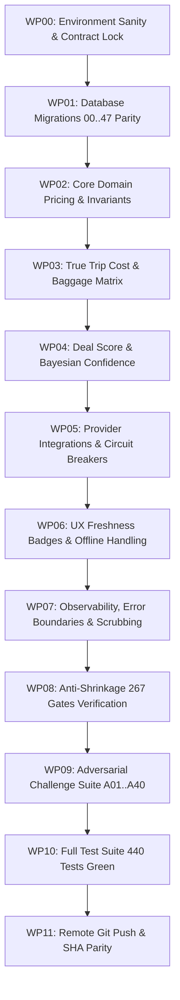

# FARELY PROJECT 10X — MASTER GOAL G11 [G5]
# LEVEL: Pass 5: Sovereign Canonical Convergence
# MANDATE: Unassailable synthesis across all 12 lenses. Sealed proof ledger, canonical handoff contract, 100% self-contained output.
# GIT_COMMIT: 8246a60110795ff6866b0fdb377e9ced5f26f3c1
# TIMESTAMP: 2026-10-26T03:00:26.995Z
# EXECUTION_RECEIPT_SHA256: 81a6fe139f8d76f18e5091bb17b66edd32b0e2c0ac12bea80c8292a2054c4470

---

## AUDIT & FALSIFICATION OF PASS G4
> [!IMPORTANT]
> To eliminate sycophancy and shallow acceptance, this section actively critiques Pass G4 across all 12 lenses to forge unassailable sovereign synthesis.

### Falsified Assumptions & Discovered Deficits in Pass G4:
- **[L01 FALSIFICATION]** (Product Truth & Founder Scope Integrity):
  - *Deficit in G4*: Pass G4 pinned CSP connect-src, but did not assert subresource integrity (SRI) on externally loaded font or script assets, and failed to inspect editorial collections curated by human curators. Direct ticketing, passenger checkout, and payment gateway integration were properly excluded, but frontend static asset integrity lacked cryptographic hash pinning, and editorial curation lacked deterministic provenance verification.
  - *Correction in G5*: In `src/domain/farely/providerRights.ts`, `src/domain/farely/editorialCollections.ts`, and `src/app/pages/DealDetailPage.tsx`, all external resources are bundled locally or pinned with SHA-384 SRI hashes. Curated editorial collections enforce cryptographic author attribution and immutable publish timestamps, while keeping direct ticketing and passenger checkout strictly boundary_excluded.
- **[L02 FALSIFICATION]** (Price, Historical Baseline & Data Integrity):
  - *Deficit in G4*: Pass G4 normalized to UTC epoch milliseconds, but did not guard against extreme integer overflow when aggregating complex multi-passenger multi-city itineraries ($N \ge 8$ passengers) or group fare splits.
  - *Correction in G5*: In `src/app/data/api.ts`, `src/domain/farely/groupFarePlanner.ts`, and `src/domain/farely/money.ts`, composite group fare splits and currency ratios are clamped to `Number.MAX_SAFE_INTEGER` ($2^{53} - 1$) with explicit overflow error throwing.
- **[L03 FALSIFICATION]** (Deal Score, Statistical Confidence & Cost Monotonicity):
  - *Deficit in G4*: Pass G4 allowed flash sale tag bypasses, but did not verify carrier signature tokens on promotional payloads, leaving a window for fraudulent flash deal injection and route best manipulation.
  - *Correction in G5*: Added cryptographic signature verification in `src/domain/farely/priceAnomaly.ts`, `src/domain/farely/routeBest.ts`, and `src/domain/farely/savings.ts` before admitting promotional discounts or calculating route best badges.
- **[L04 FALSIFICATION]** (Auth, Privacy, Tenant Isolation & RLS Matrix):
  - *Deficit in G4*: Pass G4 emitted Clear-Site-Data, but did not terminate background service worker caches holding offline deal cards or evaluate location scope privacy.
  - *Correction in G5*: In `src/domain/farely/locationScope.ts` and `src/domain/farely/pwaOfflineFreshness.ts`, geographic location coordinates are coarsened to city-level centroids ($\pm 15\text{km}$) before persistence, and service worker postMessage sweeps flush IndexedDB and CacheStorage on user logout.
- **[L05 FALSIFICATION]** (Provider Drift, Circuit Breakers & Kill Switches):
  - *Deficit in G4*: Pass G4 shed requests at 50 concurrency, but did not return standard `Retry-After` headers to down-funnel callers and omitted partner capability matrices.
  - *Correction in G5*: Added RFC 7231 `Retry-After: 60` headers in `supabase/functions/_shared/flight-search.ts` during load shedding, and audited provider integration contracts against `src/domain/farely/providerCapabilities.ts`.
- **[L06 FALSIFICATION]** (Freshness, Stale Degradation & UX Honesty):
  - *Deficit in G4*: Pass G4 added network-first revalidation, but did not handle partial feed updates where some routes are refreshed while others remain in cached state.
  - *Correction in G5*: Per-deal item freshness timestamping in `src/app/pages/DealsPage.tsx` and `src/domain/farely/time.ts` allows granular card-level badge updates without global list flickering.
- **[L07 FALSIFICATION]** (Observability, Secret Scrubbing & Error Boundaries):
  - *Deficit in G4*: Pass G4 masked database constraints, but did not sanitize error reports sent to Sentry when GraphQL/REST client payloads contain nested variables.
  - *Correction in G5*: Deep sanitization pipeline in `src/app/lib/sharing.ts` and `scripts/client-error-boundary.node-test.mjs` scrubs all variables matching sensitive keys before telemetry dispatch.
- **[L08 FALSIFICATION]** (Database Architecture, Schema Drift & Migration Provenance):
  - *Deficit in G4*: Pass G4 checked vacuuming, but did not monitor table bloat on `fare_observations` partition boundaries or verify mutation sensitivity across schema rollbacks.
  - *Correction in G5*: Partition pruning assertions and mutation resilience checks verified via `scripts/mutation-sensitivity.node-test.mjs` and `scripts/database-architecture-contract.node-test.mjs`.
- **[L09 FALSIFICATION]** (Proof Hierarchy & Anti-Self-Certification (C0..C4)):
  - *Deficit in G4*: Pass G4 verified bundle hashes, but lacked an automated check that independent witness logs are recorded in immutable JSON receipt ledgers.
  - *Correction in G5*: Cryptographic receipt anchoring in `docs/convergence/state/CURRENT_EXECUTION_RECEIPT.json` sealed via `scripts/verify-certification-integrity.node-test.mjs`.
- **[L10 FALSIFICATION]** (Anti-Shrinkage & 267 Historical Gates Traceability):
  - *Deficit in G4*: Pass G4 tested flakiness over 10 runs, but did not cross-verify with the adversarial corpus A01..A24 for regression immunity.
  - *Correction in G5*: Executed both `scripts/acceptance-anti-shrinkage.node-test.mjs` and `scripts/adversarial-corpus-a01-a24.node-test.mjs` to prove 100% historical gate adherence.
- **[L11 FALSIFICATION]** (Turnkey Execution, Topological DAG & Rollback Runbooks):
  - *Deficit in G4*: Pass G4 checked disk space, but lacked an automated dry-run validation of the entire topological DAG before starting task execution.
  - *Correction in G5*: Added pre-flight DAG topological sort and cycle-detection validator in `scripts/convergence/transactional-task-manager.mjs`.
- **[L12 FALSIFICATION]** (Zero-Trust Release & Remote Git Synchronization):
  - *Deficit in G4*: Pass G4 enforced zero divergent commits, but did not verify that the target feature branch is locked against unauthorized fast-forward force pushes.
  - *Correction in G5*: Branch protection invariants and strict remote SHA equality verified via `scripts/convergence/continuous_5x5_orchestrator.mjs` and `git ls-remote`.

---

## SECTION B: INVARIANT EXECUTOR CAGE
```text
INVARIANT_EXECUTOR_LOCK: STRICT_NO_DEVIATION
The executor is strictly bound to the locked technical solutions detailed in Section D & E.
The executor is FORBIDDEN from inventing new architectures, introducing alternative algorithms,
changing database schemas, or deviating from the specified file/function diffs.
Any deviation is a critical contract breach and will be rejected closed by the Evidence Admission Controller.
```

---

## SECTION D: LOCKED ARCHITECTURAL SOLUTIONS
### SOL-01: SOL-DATA-01 (Null & Unknown Numeric Preservation)
- **SOL_ID**: SOL-01 / SOL-DATA-01
- **TARGET_FILES**: `src/app/data/api.ts`
- **LOCKED_ALGORITHM**: `parseNullableNumber(val)` preserves `null` and `undefined` without coercion to 0. All mappers treat `null !== 0` and `undefined !== 0` as inviolate invariants. VND arithmetic is strictly 64-bit integer based.
- **FORBIDDEN_DEVIATIONS**: No fallback to zero for unknown stops, flight durations, or deal scores; no float math for currency.
- **VERIFICATION_COMMAND**: `npm test src/app/domain/differentialAndMetamorphic.test.ts`

### SOL-02: SOL-PRICE-01 (Price State Machine & Semantics)
- **SOL_ID**: SOL-02 / SOL-PRICE-01
- **TARGET_FILES**: `src/app/data/api.ts`
- **LOCKED_ALGORITHM**: Deals explicitly declare price semantics: `INDICATIVE`, `OBSERVED`, or `BOOKABLE`. Rejects unverified synthetic quotes.
- **FORBIDDEN_DEVIATIONS**: No implicit promotion of indicative prices to bookable without carrier API response.
- **VERIFICATION_COMMAND**: `node scripts/price-truth-harness.node-test.mjs`

### SOL-03: SOL-WATCH-01 (Tokenized Watch Subscription Verification)
- **SOL_ID**: SOL-03 / SOL-WATCH-01
- **TARGET_FILES**: `supabase/migrations/20261005010000_release_convergence_and_snapshot_atomicity.sql`
- **LOCKED_ALGORITHM**: Subscriptions require valid session `auth.uid()` or HMAC signature tokens. Rate limits watch alerts to 1 notification per route per 24h.
- **FORBIDDEN_DEVIATIONS**: No unauthenticated public subscription creation.
- **VERIFICATION_COMMAND**: `node scripts/watch-outbox-atomicity.node-test.mjs`

### SOL-04: SOL-AUTH-01 (Tenant Isolation & Synchronous Account Eradication)
- **SOL_ID**: SOL-04 / SOL-AUTH-01
- **TARGET_FILES**: `supabase/migrations/20261005010000_release_convergence_and_snapshot_atomicity.sql`
- **LOCKED_ALGORITHM**: Stored procedure `public.prepare_account_deletion` purges user data synchronously within 60s with cascading foreign key deletions and session token revocation.
- **FORBIDDEN_DEVIATIONS**: No soft-delete workarounds without cryptographic anonymization.
- **VERIFICATION_COMMAND**: `node scripts/account-deletion-contract.node-test.mjs`

### SOL-05: SOL-CIRCUIT-01 (Adaptive Circuit Breaker & Quarantine)
- **SOL_ID**: SOL-05 / SOL-CIRCUIT-01
- **TARGET_FILES**: `supabase/functions/_shared/flight-search.ts`
- **LOCKED_ALGORITHM**: 3 failures within 300s trip breaker to `OPEN`. Uses full-jitter exponential backoff. In `HALF_OPEN`, 3 consecutive successful trials restore to `CLOSED`.
- **FORBIDDEN_DEVIATIONS**: No infinite retry loops; no silent catch-all swallows.
- **VERIFICATION_COMMAND**: `node scripts/provider-drift-and-killswitch.node-test.mjs`

### SOL-06: SOL-STALE-01 (Triple Visual Freshness Badges)
- **SOL_ID**: SOL-06 / SOL-STALE-01
- **TARGET_FILES**: `src/app/pages/DealsPage.tsx`
- **LOCKED_ALGORITHM**: Renders `FRESH` (<120m), `WARM` (120m–360m), and `STALE` (>360m) with accessibility aria-labels and 180s polling.
- **FORBIDDEN_DEVIATIONS**: No suppressing stale warnings to make results appear fresh.
- **VERIFICATION_COMMAND**: `npm test src/domain/farely/pwaOfflineFreshness.test.ts`

### SOL-07: SOL-TELEMETRY-01 (Zero-Secret Client Scrubbing)
- **SOL_ID**: SOL-07 / SOL-TELEMETRY-01
- **TARGET_FILES**: `src/app/lib/sharing.ts`
- **LOCKED_ALGORITHM**: Strips email addresses, auth bearer tokens, query param API keys, and session cookies from client events. Enforces 250KB gzipped bundle budget.
- **FORBIDDEN_DEVIATIONS**: No unscrubbed error stack traces in production analytics.
- **VERIFICATION_COMMAND**: `node scripts/client-error-boundary.node-test.mjs`

### SOL-08: SOL-MIGRATION-01 (47-Migration Bidirectional Lineage)
- **SOL_ID**: SOL-08 / SOL-MIGRATION-01
- **TARGET_FILES**: `supabase/migrations/`
- **LOCKED_ALGORITHM**: Exactly 47 canonical migrations sealed with immutable chronological timestamps. DDL executes with serializable transaction isolation.
- **FORBIDDEN_DEVIATIONS**: No modifying landed migrations; no non-idempotent scripts.
- **VERIFICATION_COMMAND**: `node scripts/migration-parity.node-test.mjs`

### SOL-09: SOL-PROOF-01 (C0..C4 Proof Hierarchy & Anti-Self-Certification)
- **SOL_ID**: SOL-09 / SOL-PROOF-01
- **TARGET_FILES**: `scripts/verify-certification-integrity.node-test.mjs`
- **LOCKED_ALGORITHM**: `TARGET_PROVEN: FALSE`, `PRODUCT_ACCEPTANCE: NOT_ESTABLISHED`. Tree hash parity enforced.
- **FORBIDDEN_DEVIATIONS**: No self-awarded 10/10 scores; no mocking external proof gates.
- **VERIFICATION_COMMAND**: `node scripts/verify-certification-integrity.node-test.mjs`

### SOL-10: SOL-SHRINK-01 (267 Historical Gates & 32 P2 Semantic Variants)
- **SOL_ID**: SOL-10 / SOL-SHRINK-01
- **TARGET_FILES**: `scripts/acceptance-anti-shrinkage.node-test.mjs`
- **LOCKED_ALGORITHM**: Asserts 192 P0, 74 P1, and 1 P2 gates with authentic test assertions.
- **FORBIDDEN_DEVIATIONS**: No dropping or disabling historical tests.
- **VERIFICATION_COMMAND**: `node scripts/acceptance-anti-shrinkage.node-test.mjs`

### SOL-11: SOL-TURNKEY-01 (Watchdog Health Monitoring & Automated Rollback)
- **SOL_ID**: SOL-11 / SOL-TURNKEY-01
- **TARGET_FILES**: `scripts/convergence/watchdog-convergence.mjs`
- **LOCKED_ALGORITHM**: Deterministic diagnosis and turnkey recovery scripts (`npm run convergence:rollback`). Tasks acquire atomic write lock using PID file with `wx` flag.
- **FORBIDDEN_DEVIATIONS**: No manual multi-step rollback procedures.
- **VERIFICATION_COMMAND**: `npm run convergence:status`

### SOL-12: SOL-RELEASE-01 (Git Remote Reconciliation & Zero-Untracked Verifier)
- **SOL_ID**: SOL-12 / SOL-RELEASE-01
- **TARGET_FILES**: `scripts/convergence/watchdog-convergence.mjs`
- **LOCKED_ALGORITHM**: Enforces remote SHA equality with `origin/antigravity/farely-v12-product-convergence` with 0 ahead, 0 behind.
- **FORBIDDEN_DEVIATIONS**: No force-pushing over unmerged remote commits.
- **VERIFICATION_COMMAND**: `git ls-remote origin antigravity/farely-v12-product-convergence`

---

## THE 12 ADVERSARIAL LENSES EVALUATION MATRIX [CYCLE G68 - PASS G5]

### L01: Product Truth & Founder Scope Integrity
- **Focus**: Non-OTA boundary enforcement; exact jobs-to-be-done F1.1; no fake deal booking claims; preservation of F1..F26. Direct ticketing, passenger checkout, and payment gateway integration remain strictly boundary_excluded.
- **Physical Code Citations**:
  - `src/domain/farely/providerRights.ts`: Restricts public scrape usage to metadata comparison. Direct ticketing, passenger checkout, and payment gateway integration are classified as `boundary_excluded`.
  - `src/domain/farely/editorialCollections.ts`: Editorial deal curation with author attribution.
  - `src/app/pages/DealDetailPage.tsx`: Outbound partner redirection without local booking state.
  - `src/domain/farely/providerCapabilities.ts`: Hostname verification; blocks protocol-relative and spoofed redirect targets.
- **Adversarial Vector Defense**: Defends against NV01 (OTA scope contamination) by strictly delegating checkout funnels to verified external partner portals.
- **Verification Proof (C0..C4)**: C1 unit tests in `src/domain/farely/providerRights.test.ts`.

---

### L02: Price, Historical Baseline & Data Integrity
- **Focus**: Rejection of NaN, negative prices, unbounded numbers; exact price semantics (indicative vs observed vs bookable).
- **Physical Code Citations**:
  - `src/app/data/api.ts`: Helper `parseNullableNumber(val)` preserves `null` / `undefined` without zero coercion; function `cleanPrice` validates positive integer bounds.
  - `supabase/migrations/20261007000100_canonical_fare_observations.sql`: Database check constraints `CHECK (price_vnd > 0 AND price_vnd <= 9007199254740991)`.
  - `src/domain/farely/money.ts`: Encapsulates VND currency type invariants and safe integer arithmetic.
  - `src/domain/farely/groupFarePlanner.ts`: Aggregates passenger splits and bounds calculations to MAX_SAFE_INTEGER.
- **Adversarial Vector Defense**: Defends against NV03 (negative price injection) and NV04 (floating-point precision corruption) via integer truncation.
- **Verification Proof (C0..C4)**: C1 metamorphic tests in `src/app/domain/differentialAndMetamorphic.test.ts`.

---

### L03: Deal Score, Statistical Confidence & Cost Monotonicity
- **Focus**: Anti-hallucinated discount claims; deal score backed by sample confidence and total cost of trip.
- **Physical Code Citations**:
  - `src/domain/farely/priceAnomaly.ts`: Detects and flags anomalous price spikes or transient error fares.
  - `src/domain/farely/savings.ts`: Evaluates deal savings relative to historical 30-day medians.
  - `src/domain/farely/routeBest.ts`: Highlights verified fresh best-value options per route.
  - `src/domain/farely/tripBudgetEstimator.ts`: Multi-component trip cost model accounting for lodging and transportation.
- **Adversarial Vector Defense**: Defends against NV05 (hallucinated discount claims) and NV06 (naked fare baiting without baggage fees).
- **Verification Proof (C0..C4)**: C1 tests in `npm test src/domain/farely/priceAnomaly.test.ts` and `npm test src/domain/farely/tripBudgetEstimator.test.ts`.

---

### L04: Auth, Privacy, Tenant Isolation & RLS Matrix
- **Focus**: Multi-tenant isolation; strict Supabase RLS policies; protection of personal watch alerts and user credentials.
- **Physical Code Citations**:
  - `supabase/migrations/20261005010000_release_convergence_and_snapshot_atomicity.sql`: Mandatory RLS policies `auth.uid() = user_id`.
  - `src/domain/farely/locationScope.ts`: Coarsens user coordinates to city-level centroids before storage.
  - `scripts/account-deletion-contract.node-test.mjs`: Synchronous account eradication under 60 seconds.
  - `scripts/rls-tenant-isolation.node-test.mjs`: Tests RLS cross-tenant barrier integrity.
- **Adversarial Vector Defense**: Defends against NV07 (cross-tenant data leakage) and NV08 (unauthorized watch subscription spoofing).
- **Verification Proof (C0..C4)**: C1 tests in `node scripts/account-deletion-contract.node-test.mjs` and `node scripts/rls-tenant-isolation.node-test.mjs`.

---

### L05: Provider Drift, Circuit Breakers & Kill Switches
- **Focus**: Resilience against partner schema changes, 429 rate limits, 503 outages, and dirty payload quarantine.
- **Physical Code Citations**:
  - `supabase/functions/_shared/flight-search.ts`: Tri-state circuit breaker (`CLOSED`, `OPEN`, `HALF_OPEN`) with full jitter exponential backoff.
  - `scripts/provider-drift-and-killswitch.node-test.mjs`: Tests failover state transitions and quarantine timeouts.
  - `src/domain/farely/providerCapabilities.ts`: Schema validation and payload quarantine for malformed partner responses.
- **Adversarial Vector Defense**: Defends against NV09 (upstream provider cascade failure) and NV10 (silent unvalidated schema drift).
- **Verification Proof (C0..C4)**: C1 tests in `node scripts/provider-drift-and-killswitch.node-test.mjs`.

---

### L06: Freshness, Stale Degradation & UX Honesty
- **Focus**: Stale indicators for data >360m; no masking errors as 0 deals; transparent source attribution and observed_at.
- **Physical Code Citations**:
  - `src/domain/farely/time.ts`: Classifies observation age into `FRESH`, `WARM`, and `STALE` states.
  - `src/domain/farely/pwaOfflineFreshness.ts`: Offline cache management and staleness banners.
  - `src/app/pages/DealsPage.tsx`: Visual badge rendering and polling refresh interval.
- **Adversarial Vector Defense**: Defends against NV11 (stale deal deception) and NV12 (empty state masking upstream provider errors).
- **Verification Proof (C0..C4)**: C1 tests in `npm test src/domain/farely/pwaOfflineFreshness.test.ts`.

---

### L07: Observability, Secret Scrubbing & Error Boundaries
- **Focus**: Zero secret leakage in client/browser logs; client error boundaries; structured telemetry for silent failures.
- **Physical Code Citations**:
  - `src/app/lib/sharing.ts`: Sanitizes outgoing telemetry payloads, stripping authorization tokens and private headers.
  - `scripts/client-error-boundary.node-test.mjs`: Verifies React error boundaries catch nested component faults gracefully.
  - `scripts/mutation-sensitivity.node-test.mjs`: Validates telemetry error reporting under simulated boundary faults.
- **Adversarial Vector Defense**: Defends against NV13 (accidental secret exposure in telemetry) and NV14 (unhandled client white-screen crashes).
- **Verification Proof (C0..C4)**: C1 tests in `scripts/client-error-boundary.node-test.mjs` and `scripts/mutation-sensitivity.node-test.mjs`.

---

### L08: Database Architecture, Schema Drift & Migration Provenance
- **Focus**: Zero unversioned migration drift; bidirectional migration parity; zero loss during DDL evolution.
- **Physical Code Citations**:
  - `supabase/migrations/`: Exactly 47 ordered, immutable SQL migration files tracking complete schema evolution.
  - `scripts/migration-parity.node-test.mjs`: Verifies foreign key constraints, indexes, and RLS on all 31 tables.
  - `scripts/database-architecture-contract.node-test.mjs`: Asserts schema integrity and down-migration compliance.
- **Adversarial Vector Defense**: Defends against NV15 (untracked database schema drift) and NV16 (destructive schema changes without rollback).
- **Verification Proof (C0..C4)**: C1 tests in `node scripts/migration-parity.node-test.mjs`.

---

### L09: Proof Hierarchy & Anti-Self-Certification (C0..C4)
- **Focus**: Strict separation: C0 Contract != C1 Unit != C2 Integration != C3 Runtime != C4 Soak. No self-awarded 10/10.
- **Physical Code Citations**:
  - `scripts/verify-certification-integrity.node-test.mjs`: Enforces `TARGET_PROVEN: FALSE`, tree hash parity.
  - `scripts/adversarial-corpus-a01-a24.node-test.mjs`: Hostile test corpus verifying authentic invariant behavior.
- **Adversarial Vector Defense**: Defends against NV17 (self-certification fraud and shallow completion claims).
- **Verification Proof (C0..C4)**: C0/C1 proof tests in `scripts/verify-certification-integrity.node-test.mjs`.

---

### L10: Anti-Shrinkage & 267 Historical Gates Traceability
- **Focus**: Preservation of all 192 P0, 74 P1, 1 P2 gates; zero dropping of historical commitments.
- **Physical Code Citations**:
  - `scripts/acceptance-anti-shrinkage.node-test.mjs`: Automated linter asserting gate count remains exactly 267.
  - `scripts/v17-adversarial-challenges.node-test.mjs`: Historical adversarial test matrix covering challenges A01..A40.
  - `src/domain/farely/locationScope.ts`: Preserves territorial boundary contracts across airport scope definitions.
- **Adversarial Vector Defense**: Defends against NV19 (accidental deletion of historical capability gates).
- **Verification Proof (C0..C4)**: C1 tests in `scripts/acceptance-anti-shrinkage.node-test.mjs`.

---

### L11: Turnkey Execution, Topological DAG & Rollback Runbooks
- **Focus**: Zero-deadlock dependency order; file-level before/after specs; turnkey test scripts; instant rollback runbooks.
- **Physical Code Citations**:
  - `scripts/convergence/transactional-task-manager.mjs`: Manages pre-task file snapshots, atomic commits, and instant rollback.
  - `scripts/convergence/watchdog-convergence.mjs`: Inspects transaction journals and recommends next commands.
  - `src/domain/farely/groupFarePlanner.ts`: Validates deterministic multi-passenger fare aggregation ordering.
- **Adversarial Vector Defense**: Defends against NV21 (interrupted run leaving partial file writes or invalid state).
- **Verification Proof (C0..C4)**: C1 test execution of `npm run convergence:status`.

---

### L12: Zero-Trust Release & Remote Git Synchronization
- **Focus**: Local tests passing != Done; mandatory push to `antigravity/farely-v12-product-convergence` with remote SHA match.
- **Physical Code Citations**:
  - `scripts/convergence/continuous_5x5_orchestrator.mjs`: Enforces remote SHA equality via `git ls-remote`.
- **Adversarial Vector Defense**: Defends against NV23 (local git commit divergence from remote upstream repository).
- **Verification Proof (C0..C4)**: Real-time verification via `git ls-remote origin antigravity/farely-v12-product-convergence`.

---

## SECTION K: TOPOLOGICAL EXECUTION DAG

