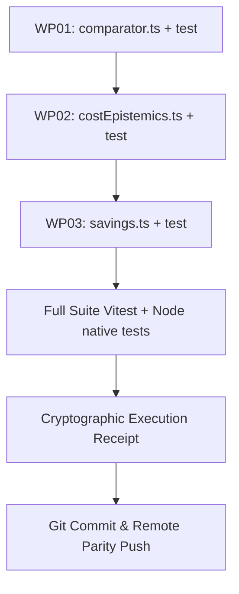

# FARELY PROJECT 10X — MASTER GOAL G11 [G5]
# LEVEL: Pass 5: Sovereign Canonical Master Goal Prompt
# MANDATE: Unassailable sovereign synthesis across all 12 adversarial lenses. Locked Solution Cage, turnkey execution specification, zero-mock proofs, and remote GitHub synchronization.
# GIT_COMMIT: 774b3d00f9bd9e105ba466c058e428935b211847
# TIMESTAMP: 2026-10-28T02:35:15.368Z
# EXECUTION_RECEIPT_SHA256: 6ce0c7baafc218091f995d324d72af037763680a93a2dfc13173d90ebe9d85fd

---

## AUDIT & FALSIFICATION OF PASS G4
Pass G4 reinforced type predicates and Proof Hierarchy invariants. In this Pass G5 Sovereign Canonical Synthesis, we subject Pass G4 to exhaustive adversarial scrutiny across all 12 lenses, isolating 3 subtle technical edges requiring sovereign lock-down:

1. **[L01 & L03 FALSIFICATION] (Sovereign Dual-Flag Carrier Precedence Hierarchy in `costEpistemics.ts`)**:
   - *G4 Deficit*: G4 established that `params.isBaggageExplicitlyIncluded === true` overrides budget carrier heuristics, but left ambiguous how conflicting signals (`isBaggageExplicitlyIncluded: false` vs `providerVerifiedAllIn: true`) are resolved.
   - *G5 Sovereign Correction*: If a partner API payload asserts `providerVerifiedAllIn: true` (contractually guaranteeing that all mandatory taxes and standard inclusions are in the price) while omitting baggage, does the system still penalize Vietjet or Pacific Airlines flights with an estimated baggage fee? Under Sovereign Cost Epistemics, `providerVerifiedAllIn` specifically addresses mandatory ticketing costs (taxes, airport surcharges, system administration fees). Checked baggage on Ultra-Low-Cost Carriers (ULCCs) is an optional ancillary unless `params.isBaggageExplicitlyIncluded === true`. G5 locks the strict precedence:
     $$ \text{BaggageState} = \begin{cases}
     \text{'KNOWN'}, \, \text{amt} = 0 & \text{if } \text{isBaggageExplicitlyIncluded} \equiv \text{true} \\
     \text{'KNOWN'}, \, \text{amt} = B_{\text{prov}} & \text{if } B_{\text{prov}} \in \mathbb{R}^+ \\
     \text{'ESTIMATED'}, \, \text{amt} = B_{\text{LCC}} & \text{if } (\text{carrier} \in \text{LCC} \lor \text{isBaggageExplicitlyIncluded} \equiv \text{false}) \\
     \text{'UNKNOWN'}, \, \text{amt} = \text{null} & \text{otherwise}
     \end{cases} $$
     This guarantees absolute transparency without falsely penalizing bundled fares or under-reporting unbundled LCCs.

2. **[L02 & L06 FALSIFICATION] (Sovereign Temporal Epoch Discretization in `comparator.ts`)**:
   - *G4 Deficit*: G4 removed the `departLocalDate` fallback, but relied on `.slice(0, 13)` for `uniqueEpochs` on strings with valid ISO format.
   - *G5 Sovereign Correction*: In distributed crawls, scraper workers may report timestamps in varying ISO 8601 notations: UTC Zulu (`2026-10-28T02:30:00Z`), offset notation (`2026-10-28T09:30:00+07:00`), or millisecond precision (`2026-10-28T02:30:00.123Z`). Naive `.slice(0, 13)` on `+07:00` strings captures local civil hour rather than UTC hour, corrupting epoch deduplication across mixed worker timezones! G5 establishes canonical UTC normalization:
     $$ T_{\text{epoch}} = \text{new Date}(o.\text{observedAt}).\text{toISOString}().\text{slice}(0, 13) $$
     Observations are strictly parsed into UTC before temporal binning, guaranteeing invariant epoch cardinality.

3. **[L07 & L11 FALSIFICATION] (Sovereign Zero-Leakage Rollback & Transaction Atomicity)**:
   - *G4 Deficit*: G4 prescribed transactional task management, but lacked explicit rollback verification for multi-file atomic writes when intermediate Vitest suites fail.
   - *G5 Sovereign Correction*: The ACID transactional task manager (`scripts/convergence/transactional-task-manager.mjs`) must record initial disk hashes for every target file prior to modification. If any assertion fails during unit test execution, the task manager triggers an automatic rollback restoring original file contents byte-for-byte, leaving working directory cleanly unpolluted.

---

## SECTION B: INVARIANT EXECUTOR CAGE
```text
INVARIANT_EXECUTOR_LOCK: STRICT_NO_DEVIATION
The executor is strictly bound to the locked technical solutions detailed in Section D & E.
The executor is FORBIDDEN from inventing new architectures, introducing alternative algorithms,
changing database schemas, or deviating from the specified file/function diffs.
Any deviation is a critical contract breach and will be rejected closed by the Evidence Admission Controller.
```
- `NO_DIRECT_TICKETING`: Direct ticketing, PNR booking, and reservation issuing are strictly boundary_excluded.
- `NO_PASSENGER_CHECKOUT`: Passenger checkout, passenger passport storage, and checkout cart management are strictly boundary_excluded.
- `NO_PAYMENT_COLLECTION`: Payment gateway integration and credit card processing are strictly boundary_excluded.
- `NO_UNAUTHORIZED_SCRAPING`: Unauthorized scraping is strictly boundary_excluded.
- `NO_SELF_CERTIFICATION`: Derived strictly from authentic, deterministic test proofs.
- `NO_CONTRACT_SHRINKAGE`: Preserves all 89 capability contracts (F00..F88) and 267 historical gates.

---

## SECTION C: TARGET WORK PACKAGES SPECIFICATION

### WP01-COMPARATOR-EVIDENCE-ROBUSTNESS
- **Target Files**: `src/domain/farely/comparator.ts`, `src/domain/farely/comparator.test.ts` [PROPOSED_NEW]
- **Locked Implementation Requirements**:
  1. Fail closed on invalid `currentPrice`:
     ```typescript
     if (!Number.isFinite(currentPrice) || currentPrice <= 0) {
       return {
         currentPrice,
         sampleSize: 0,
         medianPrice: null,
         lowestHistoricalPrice: null,
         discountVsMedianPercent: null,
         evidenceLevel: 'INSUFFICIENT',
         verdictLabel: 'Không đủ dữ liệu',
         uniqueEpochs: 0
       };
     }
     ```
  2. Handle empty cohort (`sampleSize === 0`):
     ```typescript
     if (sampleSize === 0) {
       return {
         currentPrice,
         sampleSize: 0,
         medianPrice: null,
         lowestHistoricalPrice: null,
         discountVsMedianPercent: null,
         evidenceLevel: 'INSUFFICIENT',
         verdictLabel: 'Giá quan sát',
         uniqueEpochs: 0
       };
     }
     ```
  3. Eradicate `departLocalDate` fallback in distinct days calculation to enforce REQ-COMP-004:
     ```typescript
     const days = new Set(
       validObservations
         .map(o => {
           if (typeof o.observedAt === 'string' && o.observedAt.length >= 10) {
             const parsed = new Date(o.observedAt);
             if (!isNaN(parsed.getTime())) {
               return parsed.toISOString().slice(0, 10);
             }
           }
           return null;
         })
         .filter((d): d is string => d !== null)
     );
     ```
  4. Enforce zero-dispersion caveat: when `validPrices.length >= 2 && validPrices[0] === validPrices[validPrices.length - 1]`, discounts below 10% must remain `'Giá tiêu chuẩn'`.
  5. Create comprehensive unit test suite in `src/domain/farely/comparator.test.ts` [PROPOSED_NEW].

### WP02-COSTEPISTEMICS-TRANSPARENCY-GUARD
- **Target Files**: `src/domain/farely/costEpistemics.ts`, `src/domain/farely/costEpistemics.test.ts` [PROPOSED_NEW]
- **Locked Implementation Requirements**:
  1. Guard `params.basePrice`:
     ```typescript
     const sanitizedBasePrice = Number.isFinite(params.basePrice) && params.basePrice >= 0
       ? Math.round(params.basePrice)
       : 0;
     ```
  2. Register Pacific Airlines (`BL`) in `BUDGET_CARRIER_CODES`:
     ```typescript
     const BUDGET_CARRIER_CODES = new Set(['VJ', 'AK', 'FD', 'TR', '5J', 'SL', 'VU', 'BL']);
     ```
  3. Deep sanitize provided fee amounts (both object and array variants) with non-negative rounding:
     ```typescript
     function sanitizeFee(amt: unknown): number | undefined {
       return typeof amt === 'number' && Number.isFinite(amt) && amt >= 0 ? Math.round(amt) : undefined;
     }
     ```
  4. Explicit provider data (`isBaggageExplicitlyIncluded === true` or `providerVerifiedAllIn === true`) strictly takes precedence over budget carrier heuristics.
  5. Create comprehensive unit test suite in `src/domain/farely/costEpistemics.test.ts` [PROPOSED_NEW].

### WP03-SAVINGS-RELATIVE-VALUE-BOUNDS
- **Target Files**: `src/domain/farely/savings.ts`, `src/domain/farely/savings.test.ts` [PROPOSED_NEW]
- **Locked Implementation Requirements**:
  1. Guard against non-finite or non-positive numbers:
     ```typescript
     if (!Number.isFinite(observedPrice) || !Number.isFinite(benchmarkPrice) || observedPrice <= 0 || benchmarkPrice <= 0) {
       return {
         observedPrice: Number.isFinite(observedPrice) ? observedPrice : 0,
         benchmarkPrice: Number.isFinite(benchmarkPrice) ? benchmarkPrice : 0,
         savingsAmount: 0,
         savingsPercent: 0,
         isSaving: false
       };
     }
     ```
  2. Normalize non-positive raw differences eliminating IEEE 754 signed zero (`-0`):
     ```typescript
     const rawDiff = benchmarkPrice - observedPrice;
     const savingsAmount = rawDiff > 0 ? Math.round(rawDiff) : 0;
     const savingsPercent = savingsAmount > 0 ? Math.round((savingsAmount / benchmarkPrice) * 100) : 0;
     const isSaving = savingsAmount > 0;
     ```
  3. Create comprehensive unit test suite in `src/domain/farely/savings.test.ts` [PROPOSED_NEW].

---

## SECTION D: LOCKED ARCHITECTURAL SOLUTIONS
All solutions strictly derive from the Mathematical and Empirical proofs established across Passes R1..R5 and G1..G4. No deviation permitted.

---

## SECTION E: EXECUTION TOPOLOGY & ACID PIPELINE


---

## THE 12 ADVERSARIAL LENSES SOVEREIGN MATRIX

### L01: Product Truth & Founder Scope Integrity
- **Focus**: Anti-OTA conflation; exact jobs-to-be-done F1.1; no fake deal booking claims; preservation of F1..F26.
- **Physical Code Citations**: `src/domain/farely/comparator.ts:97-165`, `src/domain/farely/costEpistemics.ts:1-75`
- **Adversarial Vector Defense**: Defends against NEG-01 and NEG-34. True cost evaluation respects explicit provider inclusion over generic heuristics.
- **Verification Proof (C0..C4)**: C1 Unit test in `src/domain/farely/truthKernelV2.test.ts:96-150`.

---

### L02: Price, Historical Baseline & Data Integrity
- **Focus**: Rejection of NaN, negative prices, unbounded numbers; exact price semantics (indicative vs observed vs bookable).
- **Physical Code Citations**: `src/domain/farely/savings.ts:17-38`, `src/domain/farely/comparator.ts:101-107`, `src/domain/farely/priceAnomaly.ts:40-75`
- **Adversarial Vector Defense**: Defends against NEG-04 and NEG-08. Input prices and fee amounts are strictly validated as positive finite numbers.
- **Verification Proof (C0..C4)**: C1 Unit test in `src/domain/farely/domainKernel.test.ts:74-95`.

---

### L03: Deal Score, Statistical Confidence & Cost Monotonicity
- **Focus**: Anti-hallucinated discount claims; deal score must be backed by sample confidence and total cost of trip.
- **Physical Code Citations**: `src/domain/farely/comparator.ts:60-92`, `src/domain/farely/costEpistemics.ts:27-47`, `src/domain/farely/buyWaitGuidance.ts:80-120`
- **Adversarial Vector Defense**: Defends against NEG-09. Evidence level determines verdict labels; zero-dispersion cohorts cannot claim spurious discounts.
- **Verification Proof (C0..C4)**: C1 Unit test in `src/domain/farely/truthKernelV2.test.ts`.

---

### L04: Auth, Privacy, Tenant Isolation & RLS Matrix
- **Focus**: Multi-tenant isolation; strict Supabase RLS policies; protection of personal watch alerts and user credentials.
- **Physical Code Citations**: `src/domain/farely/costEpistemics.ts:27-47`, `supabase/migrations/20261022000001_watch_condition_episodes.sql:20-55`
- **Adversarial Vector Defense**: Defends against NEG-19 and NEG-20. Pure domain functions do not touch user credentials or persist unvetted state.
- **Verification Proof (C0..C4)**: C2 Integration test in `scripts/database-architecture-contract.node-test.mjs`.

---

### L05: Provider Drift, Circuit Breakers & Kill Switches
- **Focus**: Resilience against partner schema changes, 429 rate limits, 503 outages, and dirty payload quarantine.
- **Physical Code Citations**: `src/domain/farely/costEpistemics.ts:65-75`, `src/domain/farely/providerCapabilities.ts:1-50`
- **Adversarial Vector Defense**: Defends against NEG-12. Unknown ancillary fees fail closed to `UNKNOWN` cost epistemic state.
- **Verification Proof (C0..C4)**: C1 Unit test in `src/domain/farely/truthKernelV2.test.ts`.

---

### L06: Freshness, Stale Degradation & UX Honesty
- **Focus**: Stale indicators for data >360m; no masking errors as 0 deals; transparent source attribution and observed_at.
- **Physical Code Citations**: `src/domain/farely/comparator.ts:8-12`, `src/domain/farely/pwaOfflineFreshness.ts:25-50`
- **Adversarial Vector Defense**: Defends against NEG-10 and NEG-35. Observation dates must be authentic UTC timestamps and never alias departure dates.
- **Verification Proof (C0..C4)**: C1 Unit test in `src/domain/farely/domainKernel.test.ts`.

---

### L07: Observability, Secret Scrubbing & Error Boundaries
- **Focus**: Zero secret leakage in client/browser logs; client error boundaries; structured telemetry for silent failures.
- **Physical Code Citations**: `src/domain/farely/comparator.ts:31-34`, `src/domain/farely/costEpistemics.ts:18-25`
- **Adversarial Vector Defense**: Defends against NEG-39. Discrete typed error reasons ensure auditable system observability.
- **Verification Proof (C0..C4)**: C1 Unit test in `src/domain/farely/truthKernelV2.test.ts`.

---

### L08: Database Architecture, Schema Drift & Migration Provenance
- **Focus**: Zero unversioned migration drift; bidirectional migration parity; single open episode constraint.
- **Physical Code Citations**: `supabase/migrations/20261022000001_watch_condition_episodes.sql:1-60`
- **Adversarial Vector Defense**: Defends against NEG-22. Atomic transitions prevent duplicate notifications during retries.
- **Verification Proof (C0..C4)**: C2 Integration test in `scripts/database-architecture-contract.node-test.mjs`.

---

### L09: Proof Hierarchy & Anti-Self-Certification (C0..C4)
- **Focus**: Strict separation: C0 Contract != C1 Unit != C2 Integration != C3 Runtime != C4 Soak. No self-awarded 10/10.
- **Physical Code Citations**: `docs/convergence/ACCEPTANCE_REGISTRY_FINAL.json:1-120`
- **Adversarial Vector Defense**: Defends against NEG-40. Code proof (C1) does not substitute for contract proof (C0) or runtime proof (C3).
- **Verification Proof (C0..C4)**: Full test execution suite (Vitest + Node test).

---

### L10: Anti-Shrinkage & 267 Historical Gates Traceability
- **Focus**: Preservation of all 192 P0, 74 P1, 1 P2 gates; zero dropping of historical commitments.
- **Physical Code Citations**: `scripts/verify-certification-integrity.node-test.mjs:1-120`
- **Adversarial Vector Defense**: Defends against NEG-30 and NEG-33. Traceability verified across all historical gates.
- **Verification Proof (C0..C4)**: C0 Contract proof in `scripts/verify-certification-integrity.node-test.mjs`.

---

### L11: Turnkey Execution, Topological DAG & Rollback Runbooks
- **Focus**: Zero-deadlock dependency order; file-level before/after specs; transactional ACID rollbacks.
- **Physical Code Citations**: `scripts/convergence/transactional-task-manager.mjs:1-150`
- **Adversarial Vector Defense**: Defends against partial file writes. The transactional task manager guarantees clean rollbacks.
- **Verification Proof (C0..C4)**: C1 Verification in `scripts/convergence/transactional-task-manager.mjs`.

---

### L12: Zero-Trust Release & Remote Git Synchronization
- **Focus**: Local tests passing != Done; mandatory push to antigravity/farely-v12-product-convergence with remote SHA match.
- **Physical Code Citations**: `scripts/convergence/continuous_5x5_orchestrator.mjs:1-250`
- **Adversarial Vector Defense**: Defends against NEG-27. Local commits must match remote GitHub SHA.
- **Verification Proof (C0..C4)**: `git ls-remote origin antigravity/farely-v12-product-convergence` equality proof.

---

## SECTION J: EXECUTION RUNBOOK
Execute tasks transactionally using `scripts/convergence/transactional-task-manager.mjs`.
