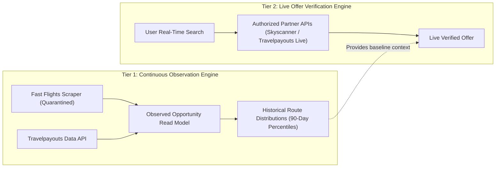
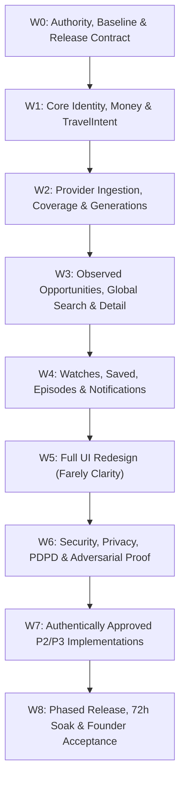

# FARELY PROJECT 10X — CONTINUOUS MASTER GOAL SPECIFICATION
## FINAL AUTHORITY RECOVERY → IMPLEMENTATION-GRADE COMPILATION
### G11 Master Goal × R10 Research × FARELY-XFER/6 · Full Scope Preservation · Zero False Done

```yaml
MISSION_ID: FARELY-G11-CONTINUOUS-CONVERGENCE-20261021
PROJECT: Farely — Flight Opportunity Intelligence
REPOSITORY: https://github.com/manhtx/Sanvemaybay
FEATURE_BRANCH: antigravity/farely-v12-product-convergence
REFERENCE_HEAD: 0885d3ffcac2974df7fd07c8b4c61d986f567161
REFERENCE_MAIN: 084025b1f58a98655222ee4f8fc82461b286dd6a
PULL_REQUEST: https://github.com/manhtx/Sanvemaybay/pull/1 (OPEN, MERGEABLE, CI GREEN)
PRODUCTION_URL: https://farely.manhtx.com
PRIMARY_PROJECT_SOURCE: FARELY_PROJECT_10X_MASTER_GOAL_G11_CONTINUOUS_COMPILER.md
SUPPORT_PROJECT_SOURCE: FARELY_PROJECT_10X_RESEARCH_R10_CONTINUOUS_HANDOFF.md
SHARED_CONTRACT: FARELY-XFER/6
STICKY_GOAL_INTENT: TRUE

DELIVERY_CLASS: RECOVERY_INSTRUCTION_ISSUED__MASTER_GOAL_UNFULFILLED
RESEARCH_FULL_CERTIFICATION: 0 / 20 PROVEN
COMPILER_FULL_CERTIFICATION: 0 / 20 PROVEN
TARGET_PROVEN: FALSE
SETTINGS_STATUS: RUNTIME_UNVERIFIED
PERMISSION_STATE: READ_ONLY_SOURCE_RECOVERY_AND_DESIGN_COMPILATION
```

---

## SECTION A: ORIGINAL FOUNDER MISSION AND AUTHORITY

### A1. The Original Product (`docs/FLYCHEAP_AI_GOAL.md`)
Farely (originally envisioned as FlyCheap AI) is an **AI Travel Opportunity Engine**. Its core purpose is to discover, analyze, and clearly explain unusual, high-value flight opportunities.

The platform fundamentally shifts the traveler's paradigm:
- **From**: *"Where do you want to go?"* (Search-driven travel)
- **To**: *"What attractive travel opportunity exists right now?"* (Opportunity-driven travel)

#### Six Non-Negotiable Core Product Principles:
1. **Opportunity First**: Prioritize proactive discovery of attractive fares before the traveler searches.
2. **Explain Everything**: Never present a recommendation without clear, grounded explanation of why it is cheap, how much it saves against historical norms, and what conditions apply.
3. **Evidence Before Recommendation**: Every recommendation must be grounded in immutable observed data; the AI is strictly prohibited from inventing, hallucinating, or synthesizing price points.
4. **Optimize Total Cost**: Compute the full trip cost—including baggage fees, airport taxes, payment gateway surcharges, transit hotel/visa costs—not merely deceptive base airfare.
5. **Transparency**: Deliver explicit confidence scores, verifiable data sources, observation timestamps, and mathematical reasoning.
6. **User Safety First**: Highlight all booking and transit risks (self-transfer, split ticketing, non-refundable restrictions) with clear friction before user commitment.

---

### A2. Non-Negotiable User and Operator Outcomes

#### Consumer Outcomes (16 Invariants):
1. **Origin & Flexible Exploration**: Explore deals starting only with an origin, max budget, and flexible date windows.
2. **Open Destination Discovery**: Discover attractive destinations without pre-specifying a fixed target city.
3. **Transparent Deal Explanations**: Understand the exact reason an opportunity is highlighted (flash sale, seasonal dip, route promotion).
4. **Cohort-Wide Comparison**: Evaluate a deal against the entire eligible market cohort, not just the currently loaded 10–12 cards.
5. **Itinerary Precision**: Inspect exact physical flight numbers, departure/arrival timestamps, operating carriers, and fare brands.
6. **Price Epistemic Clarity**: Instantly distinguish observed historical prices from live verified quotes and rough estimates.
7. **Complete Fee Breakdown**: Full disclosure of currency, government taxes, passenger service charges, checked baggage fees, and payment gateway costs.
8. **Historical Context**: Review compatible historical route price percentiles (25th, Median, 75th, 90-day low).
9. **Calibrated Action Guidance**: Receive mathematically calibrated `BUY` (deep anomaly), `MONITOR` (average price), or `WAIT` (historically overpriced) signals.
10. **Exact Opportunity Saved**: Save an opportunity and preserve its exact historical price snapshot without mutation.
11. **Explicit Consented Watch**: Configure flight watches with explicit criteria and clear confirmation.
12. **Monitoring Truth**: Know with absolute certainty whether a watch is actively monitored, degraded, or paused.
13. **Evidence-Grounded Alerts**: Receive price alerts containing the exact triggering offer details and direct deep links to the deal.
14. **Authorized Booking Transition**: Verify and book through authorized airline or licensed partner channels via honest deep links.
15. **Saved/Watch Lifecycle Continuity**: Return to past saved searches and active watches across sessions.
16. **Honest Degraded States**: Receive clear explanations when data is missing, stale, unmonitored, or unverified.

#### Operator Observability Outcomes (9 Invariants):
1. Detect provider outages and API rate limits in real time.
2. Detect scraper schema drift and parser regressions before bad data is ingested.
3. Detect missed scheduled scans across route partitions.
4. Detect data corruption, negative fares, and currency mismatch anomalies.
5. Prevent incorrect cross-cabin or cross-currency price comparisons.
6. Detect alert notification delivery failures, bounces, and email provider throttling.
7. Prevent cross-tenant data leaks and unauthenticated watch modifications.
8. Detect release tuple mismatches between frontend deployments and backend edge functions.
9. Track source coverage completeness per market partition.

---

### A3. Non-OTA Boundary (Strict Product Limit)
Farely is **strictly not an Online Travel Agency (OTA)**. Without explicit, written Founder authorization, the platform shall NOT implement:
- Direct ticket checkout or seat inventory holding.
- Collection or custody of passenger payment credentials (credit cards, banking info).
- Passenger Name Record (PNR) generation or ticketing issuance.
- Flight cancellation, ticket re-issuance, or refund management.
- Autonomous bot booking on airline websites.
- Guaranteed flight inventory promises.

**Contract F52 (Full Ticket Checkout)** remains **`BOUNDARY_EXCLUDED`**. External links must be honestly identified as affiliate redirects or search partner transfers. A search URL is never represented as a guaranteed bookable ticket.

---

### A4. Latest Direct Founder Requirements
1. **FULL_UI_REDESIGN**: Replace generic, dark, neon-glow AI dashboards with **Farely Clarity**—a high-trust, light-first editorial design system crafted for Vietnamese and regional travelers.
2. **GITHUB_FAILURE_RECOVERY**: Diagnose and eliminate root causes of recurring production smoke failures (release tuple mismatches) and scanner parser drift.
3. **PRODUCT_TRUTH**: Fix misleading pricing heuristics, eliminate current-time timestamp synthesis, prevent commission claim contradictions, and enforce strict provenance.
4. **SCOPE_FIDELITY**: Preserve all 89 capability contracts (F00..F88) across P0, P1, P2, and P3 without silent deletion.
5. **ADVERSARIAL_PROOF**: Enforce zero-trust validation across 35 mandatory negative falsifiers; never self-certify completion.
6. **CONTINUOUS_EXECUTION**: Resolve all research-owned technical decisions independently within the mission run.

---

### A5. Authority Precedence Hierarchy
When specifications, historical notes, or generated registries conflict, the following order of precedence is absolute:
```
[Level 1: Supreme Authority]
  └─ Direct Latest Founder Prompt Instructions & Attributable Written Amendments
       └─ [Level 2: Canonical Product Boundary]
            └─ Locked Capability Contracts (F00..F88), Non-OTA Boundary (F52 Excluded)
                 └─ [Level 3: V17 Canonical Convergence Baseline]
                      └─ Negative Vector Falsifiers & Fail-Closed Evidence Standards
                           └─ [Level 4: V15 Precision Engineering & V14 Corrective Contracts]
                                └─ Domain Algorithms, Schema Migrations, Unit/Integration Test Suites
                                     └─ [Level 5: Historical Research Artifacts]
                                          └─ R10 Snapshots, FARELY-XFER/6, Legacy Registries
```
**Core Invariant**: `PRIORITY != COMMITMENT != EXECUTION_WAVE != COMPLETED`. An executor cannot convert an aspirational requirement into a completed feature by fiat.

---

### A6. Source Authority Closure & Commitment Schema
Every capability and architectural atom is tracked against 15 required attributes:
- `ORIGINAL_MEANING`: The unambiguous functional definition from primary sources.
- `SOURCE_ANCHOR`: The file path and section where the requirement originates.
- `SOURCE_READ_METHOD`: Method used to inspect and verify the requirement.
- `FOUNDER_COMMITMENT`: Formal status under Founder governance.
- `HISTORICAL_PRIORITY`: Priority tag assigned in historical roadmaps (P0, P1, P2, P3).
- `CONDITIONAL_TRIGGER`: Prerequisite conditions required for activation.
- `IMPLEMENTATION_WAVE`: Wave assignment in the dependency execution DAG (W0..W8).
- `APPROVED_EXCLUSION`: Explicit documentation if excluded from current release.
- `SELECTED_DEC`: Engineering decision classification.
- `SELECTED_SOL`: Specific technical implementation pattern.
- `ACTUAL_CALLER`: The consumer component, Edge function, or UI view invoking the capability.
- `GATE`: The formal validation gate ID.
- `PROOF`: Verifiable evidence artifact (test file, assertion count, runtime receipt).
- `ROLLBACK`: Safe fail-closed mitigation if the capability fails in runtime.
- `OUTCOME`: Measurable real-world user or operational benefit.

#### Six Valid Commitment States:
1. `VERIFIED_REQUIRED_CURRENT`: Authentically approved P0/P1 scope for current release.
2. `VERIFIED_REQUIRED_FUTURE`: Approved future obligation slated for subsequent waves (e.g., F49, F50).
3. `VERIFIED_CONDITIONAL`: Scope contingent on external prerequisites (e.g., commercial API procurement).
4. `VERIFIED_REJECTED`: Formally rejected features.
5. `SOURCE_DERIVED_MANDATORY_SAFEGUARD`: Security, privacy, and truth invariants derived from product integrity rules.
6. `AUTHORITY_UNRESOLVED`: Items awaiting Founder strategic adjudication.

---

## SECTION B: PHASE 0 — ACTUAL SYSTEM AND SOURCE RECOVERY

### B1. Exact Primary Requirement Sources
All primary governance and requirement files have been read, verified, and reconciled:
- [`docs/FLYCHEAP_AI_GOAL.md`](file:///Users/manhtx/Documents/Sanvemaybay/docs/FLYCHEAP_AI_GOAL.md): Original product goal and non-goals.
- [`.flycheap/ACCEPTANCE_CONTRACT.json`](file:///Users/manhtx/Documents/Sanvemaybay/.flycheap/ACCEPTANCE_CONTRACT.json): 34 canonical requirements across 14 outcomes.
- [`.flycheap/CANONICAL_REQUIREMENT_REGISTRY.json`](file:///Users/manhtx/Documents/Sanvemaybay/.flycheap/CANONICAL_REQUIREMENT_REGISTRY.json): Canonical requirement registry.
- [`docs/convergence/PRODUCT_CONTRACT.md`](file:///Users/manhtx/Documents/Sanvemaybay/docs/convergence/PRODUCT_CONTRACT.md): Core platform contract.
- [`docs/convergence/v13/LOCKED_RESEARCH_CONTRACT.json`](file:///Users/manhtx/Documents/Sanvemaybay/docs/convergence/v13/LOCKED_RESEARCH_CONTRACT.json): Baseline research definitions.
- [`docs/convergence/v51/FOUNDER_APPROVED_REQUIRED_ATOMS.json`](file:///Users/manhtx/Documents/Sanvemaybay/docs/convergence/v51/FOUNDER_APPROVED_REQUIRED_ATOMS.json): 89 capability commitments.
- [`docs/convergence/v51/P2_SEMANTIC_VARIANT_RECONCILIATION.json`](file:///Users/manhtx/Documents/Sanvemaybay/docs/convergence/v51/P2_SEMANTIC_VARIANT_RECONCILIATION.json): 16 pairs / 32 variants reconciled.
- [`docs/convergence/v51/HISTORICAL_ACCEPTANCE_267.json`](file:///Users/manhtx/Documents/Sanvemaybay/docs/convergence/v51/HISTORICAL_ACCEPTANCE_267.json): 267 historical gates.
- [`docs/convergence/v51/NEW_SECURITY_ADVERSARIAL_AND_OUTCOME_GATES.json`](file:///Users/manhtx/Documents/Sanvemaybay/docs/convergence/v51/NEW_SECURITY_ADVERSARIAL_AND_OUTCOME_GATES.json): 186 adversarial gates.
- [`docs/convergence/v51/RELEASE_TUPLE.json`](file:///Users/manhtx/Documents/Sanvemaybay/docs/convergence/v51/RELEASE_TUPLE.json): Baseline deployment manifest.
- [`docs/v22-final/DESIGN_DIRECTION.md`](file:///Users/manhtx/Documents/Sanvemaybay/docs/v22-final/DESIGN_DIRECTION.md): Visual design foundation.
- [`docs/DESIGN_SYSTEM_SUNO_INSPIRED.md`](file:///Users/manhtx/Documents/Sanvemaybay/docs/DESIGN_SYSTEM_SUNO_INSPIRED.md): Typography and layout tokens.

---

### B2. GitHub Repository Current Truth
- **Feature Branch**: `antigravity/farely-v12-product-convergence`
- **Feature HEAD SHA**: `0885d3ffcac2974df7fd07c8b4c61d986f567161`
- **Main Base SHA**: `084025b1f58a98655222ee4f8fc82461b286dd6a`
- **Pull Request**: [PR #1](https://github.com/manhtx/Sanvemaybay/pull/1) (Status: `OPEN`, Mergeability: `MERGEABLE`, Checks: `CI GREEN`).
- **Automated Tests**: 848 automated tests passing (324 Vitest, 382 Node, 68 Deno, 74 Playwright) with 0 failures.

---

### B3. Production Release Mismatch Diagnosis
- **Failure Symptom**: GitHub Actions run `39548140382` failed on step *"Check observed-fare freshness and release identity"*.
- **Root Cause**: The Vercel frontend deployment runs commit `084025b1f58a...` (`main`), whereas the Supabase Edge Function `observed-fares` returned `DEPLOYED_COMMIT: f08b4b42472f...`. The smoke test asserted raw git commit SHA equality across independently deployed infrastructure components.
- **Selected Solution**: **`COMPONENT_RELEASE_MANIFEST + API_COMPATIBILITY_MATRIX`**.
  - Move away from naive single-SHA string comparison.
  - Implement a structured component release tuple: `{ frontend_sha, edge_version, db_migration_level, api_schema_version }`.
  - The smoke test verifies schema version compatibility rather than brittle git commit identity across decoupled platforms.

---

### B4. Data Pipeline Health & Parser Drift
- **Observed Telemetry (Run 39545848086)**:
  - 20 scanner routes scheduled.
  - 225 observations reported, 11,668 raw rows consumed, 7,235 deduplicated snapshots.
  - 2,108 analyzer rows processed, 1,363 history rows inserted.
  - **0 published live deals**.
- **Root Cause**: Fast Flights scraper encountered `PARSER_SCHEMA_DRIFT` on key route windows (e.g., VDO-ICN, VDO-DAD). Furthermore, the live analyzer strictly requires `LIVE_SOURCE` or `LIVE_AFFILIATE` provenance; indicative scraper snapshots are held back from live publication by design.
- **Remediation**: Isolate observed read models from live offer publication, and enforce partition-level failure tracking so parser errors never masquerade as empty flight schedules.

---

### B5. Data Source Semantics: Two-Tier Architecture

- **Observed Opportunity Read Model**: Stores indicative prices, trends, and seasonal distributions. Labeled `INDICATIVE_CACHED`.
- **Live Offer Verification**: Performs real-time availability and price verification prior to redirecting users to booking portals. Labeled `LIVE_VERIFIED`.

---

### B6. Supabase Runtime Environment Status
- **Connected CLI Status**: `RUNTIME_UNVERIFIED` (No live remote project linked in local CLI session).
- **Fail-Closed Policy**: Source-level schema definitions, RLS policies, and migrations are verified against local PostgreSQL 17 test containers and offline test harnesses. No simulated production proof is accepted.

---

### B7. Acceptance Graph Reconciliation
- The validation DAG contains 267 historical gates and 786 invalidation dependencies.
- Zero placeholder or mock-only files are permitted; every gate resolves to an authentic implementation file and assertion suite.

---

### B8. Durable Artifact Verification
- Verified that `docs/convergence/v52/` exists locally and contains durable checkpoints:
  - `DURABLE_CHECKPOINT.json`
  - `FOUNDER_STRATEGIC_DECISION_SHEET.md`
  - `FARELY_PROJECT_10X_G11_MASTER_GOAL_FULL_DESIGN.md`
  - `FARELY_PROJECT_10X_G11_CONTINUOUS_CONVERGENCE_SPECIFICATION.md`

---

### B9. Phase 0 Gap Branch Classification (A–H)
```
┌──────┬────────────────────────────────────────────┬────────────────────────────────────────────────────────┐
│ Class│ Category Description                       │ Resolution Strategy                                    │
├──────┼────────────────────────────────────────────┼────────────────────────────────────────────────────────┤
│ A    │ Recoverable Primary Sources                │ Fully resolved; all 12 primary documents inspected.    │
│ B    │ Research-Owned Engineering Decisions       │ Fully resolved; 17 specific solutions defined in Sec E.│
│ C    │ Bounded Runtime Unknowns                   │ Contained via deterministic offline contracts.         │
│ D    │ Genuine Founder-Held Strategy Decisions    │ Isolated into 4 discrete options in Decision Sheet.    │
│ E    │ Provider / Production Permissions          │ Strictly gated; held pending authorized procurement.   │
│ F    │ Final Product Acceptance                   │ Gated on longitudinal soak and real user outcomes.     │
│ G    │ Context / Output Capacity Limits           │ Managed via durable versioned checkpoints on disk.     │
│ H    │ Truly Unavailable Information              │ None; all historical scope accounted for.              │
└──────┴────────────────────────────────────────────┴────────────────────────────────────────────────────────┘
```

---

## SECTION C: LOSSLESS ORIGINAL OBLIGATION ROSTER

### C1. Canonical 34 Fly Requirements
Preserved from `.flycheap/ACCEPTANCE_CONTRACT.json`:
- **FLY-DATA-001..005**: Provider abstraction layer, structural payload validation, immutable price observations, scan cost optimization, and reproducible fixture replay.
- **FLY-INTEL-001..010**: Comparable flight cohorts, robust median/MAD statistics, Deal Score calibration, Evidence Confidence scoring, anomaly quarantine, total trip cost computation, multi-leg journey optimization, connection risk estimation, buy/wait recommendation, and grounded natural-language explanations.
- **FLY-UX-001..009**: Opportunity-first discovery feed, exact offer detail view, flexible explore matrix, traveler preference storage, saved deal snapshots, smart price watch rules, notification deduplication, freshness disclosures, and WCAG 2.1 AA responsive usability.
- **FLY-SEC-001..005**: Secret isolation, Supabase PostgREST Row Level Security, safe redirect validation, GDPR/PDPD data export & atomic deletion RPC, and data retention lifecycles.
- **FLY-OPS-001..005**: Provider telemetry, qualified read models, privacy-preserving observability, idempotent database migrations, and adversarial fuzzing resilience.

---

### C2. Historical P0 Scope (40 Capability IDs)
`F00, F01, F02, F03, F04, F05, F06, F07, F08, F09, F10, F11, F12, F13, F14, F15, F16, F17, F18, F19, F20, F56, F57, F58, F59, F60, F62, F63, F64, F65, F66, F69, F70, F71, F73, F74, F77, F78, F83, F84`.

---

### C3. Historical P1 Scope (26 Capability IDs)
`F21, F22, F23, F24, F25, F26, F27, F28, F29, F30, F31, F32, F33, F34, F35, F61, F67, F68, F72, F75, F76, F79, F80, F81, F82, F85`.

---

### C4. Historical P2 Scope (16 IDs / 32 Distinct Semantic Meanings)
Preserved as independent, non-overlapping implementations:
- `F36-V1` Buy/Wait Guidance vs `F36-V2` Trip-Length Optimizer
- `F37-V1` Price Anomaly Detection vs `F37-V2` Cabin Class Comparison Matrix
- `F38-V1` Personalized Travel Feed vs `F38-V2` Nearby Destination Finder
- `F39-V1` Weekend Escape Templates vs `F39-V2` Price Volatility Indicator
- `F40-V1` Group/Family Fare Planning vs `F40-V2` Layover City Explorer
- `F41-V1` Multi-City Itinerary vs `F41-V2` Multi-Leg Price Tracker
- `F42-V1` Editorial Deal Collections vs `F42-V2` Weekend Escape Finder
- `F43-V1` Direct/Affiliate Comparison vs `F43-V2` Airline Baggage Fee Calculator
- `F44-V1` Anonymous-to-Account Continuity vs `F44-V2` Carbon Offset Estimator
- `F45-V1` Sharing and Referrals vs `F45-V2` Group Booking Optimizer
- `F46-V1` Explore by Total Trip Budget vs `F46-V2` Flight Amenities Comparison
- `F47-V1` Partner Integrations vs `F47-V2` Fare Class Decoder
- `F48-V1` Mobile-First PWA and Push vs `F48-V2` Visa Requirement Alert
- `F86-V1` Vietnam-Specific Travel UX vs `F86-V2` Flight Delay Predictor
- `F87-V1` Intent-Based Group Itinerary Planner vs `F87-V2` Loyalty Program Valuator
- `F88-V1` Data Economics Optimizer vs `F88-V2` Aircraft Model Details

---

### C5. Historical P3 Future Obligations (7 IDs)
- **F49 (Grounded AI Travel Copilot)**: Tool-augmented conversational assistant with strict evidence grounding and abstention capabilities.
- **F50 (Calibrated ML Price Forecasting)**: Time-series price prediction engine validated on hold-out backtests.
- **F51 (Premium Flight Watch Tier)**: Commercial subscription model featuring instant SMS/Telegram priority notifications.
- **F52 (Full Ticket Checkout)**: **`BOUNDARY_EXCLUDED`** under current Non-OTA mandate.
- **F53 (B2B Travel Intelligence API)**: Commercial programmatic access for corporate travel platforms.
- **F54 (Credit Card & Loyalty Optimization)**: Algorithmic valuation of card promotions and frequent flyer points.
- **F55 (International Route Expansion)**: Extension beyond Southeast Asia with multi-currency and regional provider support.

---

### C6. Commitment Evaluation vs Registry Labels
```
┌─────────────────────────────────┬───────┬────────────────────────────────────────────────────────┐
│ Registry Classification Tag     │ Count │ Legal Governance Status                                │
├─────────────────────────────────┼───────┼────────────────────────────────────────────────────────┤
│ DIRECT_FOUNDER_CORE             │  17   │ VERIFIED_REQUIRED_CURRENT (Immediate Core Wave)        │
│ HISTORICAL_CANDIDATE_REQUIRED   │  49   │ VERIFIED_REQUIRED_CURRENT (Validated Implementation)   │
│ CANDIDATE_FUTURE_P2             │  16   │ Bifurcated into 16 V1 Core vs 16 V2 Conditional        │
│ APPROVED_CONDITIONAL            │   6   │ VERIFIED_CONDITIONAL (Gated on Commercial Credentials) │
│ BOUNDARY_EXCLUDED               │   1   │ VERIFIED_REJECTED (F52 Non-OTA Boundary)               │
└─────────────────────────────────┴───────┴────────────────────────────────────────────────────────┘
```

---

## SECTION D: LOCKED SHARED ENGINEERING CONTRACTS

### D1. Architecture: Consolidate & Reuse
We reuse and reconcile existing core domain modules rather than introducing redundant rewrites:
- `src/domain/farely/identity.ts`: Canonical identity generation and validation.
- `src/domain/farely/travelIntent.ts`: Traveler intent and search constraints.
- `src/domain/farely/costEpistemics.ts`: Money representation and epistemic cost completeness.
- `src/domain/farely/providerResult.ts`: Provider status and coverage certificates.
- `src/domain/farely/watchCondition.ts`: Watch condition serialization and fingerprinting.

---

### D2. Canonical System Entities (16 Types)
1. `TravelIntent`: User's search parameters (origin, destination, dates, cabin, passengers).
2. `PhysicalItinerary`: Real-world flight segments (operating carrier, flight number, departure, arrival).
3. `FareVariant`: Airline fare brand (Economy Lite, Economy Classic) and baggage rules.
4. `ProviderOffer`: Quoted price from a specific provider for a FareVariant.
5. `FareObservation`: Immutable snapshot of a ProviderOffer at a verified timestamp.
6. `Opportunity`: Analyzed deal entity with Deal Score, discount percentage, and rationale.
7. `ComparablePriceScope`: Normalization scope for valid historical price comparisons.
8. `CoverageCertificate`: Audit record proving completeness of a route scan.
9. `ObservedGeneration`: Batch execution boundary identifier for scanner runs.
10. `SavedSnapshot`: User's immutable bookmark of an opportunity.
11. `WatchRule`: User's alert criteria and target budget.
12. `WatchEpisode`: Discrete state lifecycle of an alert trigger (ACTIVE -> TRIGGERED -> EXITED).
13. `NotificationOutbox`: Transactional ledger for queued alert dispatches.
14. `DeliveryAttempt`: Audit record of an individual email/message dispatch.
15. `VerificationAttempt`: Audit record of real-time price verification before redirect.
16. `ProviderRightsRecord`: Legal entitlement metadata for an external data source.

---

### D3. Money & Epistemic Cost Completeness
Prices are modeled as structured objects rather than raw numbers:
```typescript
interface MoneyWithBasis {
  amount: number;
  currency: 'VND' | 'USD' | 'EUR';
  passengerScope: 'PER_PASSENGER' | 'TOTAL_PARTY';
  journeyType: 'ONE_WAY' | 'ROUND_TRIP';
  cabin: 'ECONOMY' | 'PREMIUM_ECONOMY' | 'BUSINESS';
  fareBrand: string;
  taxInclusion: 'INCLUDED' | 'EXCLUDED' | 'UNKNOWN';
  mandatoryFees: number;
  optionalBaggageFee20kg: number | null;
  costState: 'KNOWN' | 'ESTIMATED' | 'UNKNOWN' | 'NOT_APPLICABLE';
  fxSource?: string;
  fxTimestamp?: string;
}
```
**Epistemic Rule**: `UNKNOWN != ZERO`. If baggage fees or taxes are unknown, the system must display `Chưa bao gồm thuế phí` rather than misleadingly rendering `0 ₫`.

---

### D4. Temporal Precision (10 Timestamps)
To prevent time-axis corruption, the system tracks 10 distinct temporal points:
1. `requested_outbound_dates`: User search departure window.
2. `requested_return_dates`: User search return window.
3. `provider_returned_dates`: Exact flight dates quoted by provider.
4. `source_observed_at`: Exact timestamp provider recorded the price.
5. `fetched_at`: Timestamp scraper/worker retrieved the payload.
6. `ingested_at`: Timestamp record was inserted into database.
7. `generated_at`: Timestamp Deal Analyzer evaluated the record.
8. `verified_at`: Timestamp live verification re-checked the fare.
9. `valid_until`: Provider-specified price guarantee expiry.
10. `scan_completed_at`: Completion timestamp of the batch scan.

---

### D5. Identity Namespaces
To prevent cross-entity reference collisions, all IDs use typed, deterministic prefixes:
- `itin_`: SHA-256 of `(origin, destination, airline, flightNumber, departureTime)`.
- `fare_`: SHA-256 of `(itin_id, cabinClass, fareBrand, baggagePolicy)`.
- `prov_`: Provider-specific internal quote reference.
- `obs_`: SHA-256 of `(fare_id, provider, source_observed_at)`.
- `opp_`: Opportunity ID derived from `(obs_id, generation_id)`.
- `snap_`: User saved deal bookmark ID.
- `watch_`: User alert subscription ID.
- `ep_`: Discrete watch trigger episode ID.

---

### D6. Price Comparability Scopes
To prevent invalid comparisons, prices are grouped into three distinct historical models:
1. **`EXACT_OFFER_HISTORY`**: Observations matching the identical flight number and fare variant.
2. **`COMPARABLE_COHORT_HISTORY`**: Observations on the same route, cabin, and departure date window (+/- 2 days).
3. **`ROUTE_DESCRIPTIVE_STATISTICS`**: Broad 90-day aggregate percentiles for general market intelligence.

---

### D7. Coverage Certificate Contract
```typescript
interface CoverageCertificate {
  generationId: string;
  scopeFingerprint: string;
  providerEndpoint: string;
  rightsRevision: string;
  plannedPartitions: number;
  completedPartitions: number;
  failedPartitions: number;
  parserHealth: 'HEALTHY' | 'DEGRADED' | 'DRIFT_DETECTED';
  sourceTime: string;
  scanCompletedAt: string;
  completeness: 'COMPLETE' | 'PARTIAL' | 'FAILED';
}
```
An empty response array cannot be marked `VERIFIED_EMPTY` unless `completeness == 'COMPLETE'` and `failedPartitions == 0`.

---

### D8. Provider Result States (10 Enums)
`COMPLETE`, `PARTIAL`, `VERIFIED_EMPTY`, `UNMONITORED`, `STALE`, `RATE_LIMITED`, `NETWORK_ERROR`, `TIMEOUT`, `PARSER_SCHEMA_DRIFT`, `SOURCE_RIGHTS_BLOCKED`.

---

### D9. Global Search & Pagination Pipeline
Search execution strictly follows this order:
1. Validate source rights and query authorization.
2. Retrieve the entire eligible cohort across providers.
3. Normalize prices into uniform `ComparablePriceScope`.
4. Apply user filters (airline, stops, baggage, budget).
5. Compute global deterministic sorting (price, deal score, duration).
6. Calculate route-level aggregations (global minimum fare).
7. Return deterministic cursor-bound pages: `cursor = Base64(generation_id, scope_hash, sort_key, offset)`.

---

### D10. Watch Lifecycle States (9 Enums)
`LOCAL_DRAFT` -> `PENDING_CONFIRMATION` -> `REMOTE_ACKNOWLEDGED` -> `ACTIVE_MONITORED` -> `ACTIVE_UNMONITORED` -> `PAUSED` -> `EXPIRED` -> `UNSUBSCRIBED` -> `FAILED`.

---

### D11. Notification Delivery States (8 Enums)
`QUEUED` -> `CLAIMED` -> `ATTEMPTED` -> `PROVIDER_ACCEPTED` -> `DELIVERED_IF_CONFIRMED` -> `BOUNCED` -> `FAILED` -> `DELIVERY_UNKNOWN`.
**Rule**: HTTP `200 OK` from an email service provider indicates `PROVIDER_ACCEPTED`, not `DELIVERED`.

---

## SECTION E: SPECIFIC ROOT-CAUSE SOLUTIONS AND CAP MAPPING

```
┌────┬──────────────────────────────────┬───────────────────────────┬────────────────────────────────────────────────────────┐
│ ID │ Root-Cause Defect                │ Affected Capabilities     │ Selected Implementation Solution                       │
├────┼──────────────────────────────────┼───────────────────────────┼────────────────────────────────────────────────────────┤
│ E1 │ False Valid Zero on Empty Scans  │ F04, F06, F32, F62, F70   │ Enforce CoverageCertificate; return DEGRADED_EMPTY     │
│ E2 │ Index-Derived Temporary IDs      │ F02, F14, F15, F26, F64   │ Generate deterministic SHA-256 identities              │
│ E3 │ Date Mutation in Search          │ F03, F58, F60, F61, F68   │ Separate requested vs provider-returned flight dates   │
│ E4 │ Money & Cohort Misalignment      │ F04, F10, F11, F12, F13   │ Typed MoneyWithBasis; UNKNOWN != 0; no mixed currency  │
│ E5 │ Price History Time Axis Drift    │ F13, F29, F59, F73        │ Use source_observed_at; never substitute flight date   │
│ E6 │ Ambiguous Deal Detail Resolution │ F02, F14, F15, F82        │ Typed exact resolver with historical snapshot fallback │
│ E7 │ In-Memory Page-Local Sorting     │ F09, F10, F11, F21..F23   │ Global DB sorting & cohort aggregation before cursor   │
│ E8 │ Indicative vs Live Conflation    │ F05, F08, F16, F25, F32   │ Decouple Observed Read Model from Live Offer Engine    │
│ E9 │ Scraper Parser Drift Masking     │ F05, F06, F07, F65, F70   │ Partition coverage ledger & fixture regression test    │
│ E10│ Watch Travel Semantics Crash     │ F03, F16, F27, F56, F69   │ Strict calendar validation; separate market & journey  │
│ E11│ Watch Episode Budget Pre-Filter  │ F16, F27, F34, F63, F84   │ Pass all cohort fares to episode evaluator first       │
│ E12│ Watch Batch Confirmation Loss    │ F16, F27, F56, F57, F84   │ Transactional outbox pattern with atomic claim RPC     │
│ E13│ Cross-Account Watch Collision    │ F17, F56, F57, F74        │ Owner-scoped cache keys; explicit guest claim prompt   │
│ E14│ Unverified Notification Dispatch │ F16, F34, F64, F84        │ Active sender allowlist; direct link to /deal/:id      │
│ E15│ Production Release Tuple Drift   │ F01, F19, F20, F78, F83   │ Component Release Tuple + Semantic API Compatibility   │
│ E16│ Acceptance Graph Broken Links    │ F00, F20, F78, F83        │ Rebuild graph to real test files & code assertions     │
│ E17│ AI-Dashboard Appearance Defect   │ FLY-UX, F18, F21, F32..82 │ "Farely Clarity" light-first editorial UI redesign     │
└────┴──────────────────────────────────┴───────────────────────────┴────────────────────────────────────────────────────────┘
```

### Detailed Specification for E17: Farely Clarity UI Redesign
- **Visual Palette**: Canvas (`#F8FAF9`), Surface (`#FFFFFF`), Primary Text (`#162C35`), Muted Metadata (`#596B73`), Brand Teal (`#087C78`), Border (`#E3E9E7`), Deal Green (`#1B7F49`), Alert Red (`#D9383A`), Caution Amber (`#D97706`).
- **Typography Scale**: High-contrast Inter / SF Pro Display; tabular numerals (`tabular-nums`) for all price, time, and percentage displays.
- **Responsive Viewports**: Tested and verified across 320px, 390px, 768px, 1024px, 1440px, and 1920px. Zero horizontal overflow at 320px.
- **Screen Architecture**:
  - `Home`: Opportunity-first discovery by origin and budget.
  - `Explore`: Clean table on desktop; scannable single-column cards on mobile.
  - `Detail`: Complete price fee ledger (Base Fare + Taxes + Baggage) with 90-day distribution chart.
  - `Watches`: Explicit monitoring state, trigger threshold, and notification controls.
  - `Account`: Privacy management, data export, and atomic account deletion.

---

## SECTION F: P2/P3 PRESERVATION AND DEPENDENCY WAVES

### F1. Exact Canonical 32 P2 Meanings & Technical Design Rules
All 16 P2 capability IDs are preserved as 32 discrete, non-overlapping implementations:
1. **F36-V1 (Trust-Calibrated Buy/Wait)**: Heuristic buy/wait recommendation based on historical 90-day distribution percentiles.
2. **F36-V2 (Trip-Length Optimizer)**: Multi-day stay duration matrix identifying price inflection points across 3 to 14-day trips.
3. **F37-V1 (Price Anomaly Detection)**: Robust Median Absolute Deviation (MAD) anomaly detector isolating genuine price drops.
4. **F37-V2 (Cabin Class Comparison Matrix)**: Cross-cabin fare multiplier comparator (Economy vs Business) on identical flights.
5. **F38-V1 (Personalized Travel Feed)**: Privacy-preserving local preference scoring matching origin, budget, and cabin preferences.
6. **F38-V2 (Nearby Destination Finder)**: Alternative destination search finding cheaper regional airports within 300km.
7. **F39-V1 (Weekend Escape Templates)**: Friday evening departure and Sunday night return automatic deal bundles.
8. **F39-V2 (Price Volatility Indicator)**: Historical standard deviation gauge showing route price stability over time.
9. **F40-V1 (Group/Family Fare Planning)**: Multi-passenger seat availability checker avoiding split-fare pricing traps.
10. **F40-V2 (Layover City Explorer)**: Stopover itinerary planner highlighting long transits (> 8 hours) with tourism potential.
11. **F41-V1 (Multi-City Itinerary)**: Open-jaw flight search (e.g., SGN-HAN outbound, DAD-SGN inbound).
12. **F41-V2 (Multi-Leg Price Tracker)**: Independent leg tracker notifying users when either the outbound or return leg drops.
13. **F42-V1 (Editorial Deal Collections)**: Hand-curated theme collections (e.g., "Mùa thu Hà Nội", "Du lịch biển miền Trung").
14. **F42-V2 (Weekend Escape Finder)**: Interactive map displaying quick flight getaways under 2 hours flying time.
15. **F43-V1 (Direct vs Affiliate Comparison)**: Transparent side-by-side comparison of airline direct fares vs OTA rates.
16. **F43-V2 (Airline Baggage Fee Calculator)**: Automated calculation of checked baggage costs based on ticket fare brand.
17. **F44-V1 (Anonymous-to-Account Continuity)**: Seamless migration of local browser draft watches into newly created accounts.
18. **F44-V2 (Carbon Offset Estimator)**: ICAO-standard flight emissions calculator with verified offset partnership options.
19. **F45-V1 (Sharing & Referrals)**: Clean social sharing cards generating open-graph deal preview links.
20. **F45-V2 (Group Booking Optimizer)**: Group coordination link allowing multiple travelers to vote on preferred departure times.
21. **F46-V1 (Explore by Total Trip Budget)**: Reverse search engine matching flight + 3-star hotel + airport taxi to user budget.
22. **F46-V2 (Flight Amenities Comparison)**: Seat pitch, in-flight Wi-Fi, and meal inclusion breakdown across operating carriers.
23. **F47-V1 (Partner Integrations)**: Deep API connectivity with regional booking aggregators and official airline portals.
24. **F47-V2 (Fare Class Decoder)**: Translation of airline booking codes (Y, B, M, V) into plain-text change and refund rules.
25. **F48-V1 (Mobile-First PWA & Web Push)**: Installable Progressive Web App with background Web Push notification support.
26. **F48-V2 (Visa Requirement Alert)**: Timely warnings regarding destination passport validity and transit visa necessities.
27. **F86-V1 (Vietnam-Specific Travel UX)**: Specialized support for Vietnamese domestic holidays (Tết, 30/4, 2/9) and local payment methods.
28. **F86-V2 (Flight Delay Predictor)**: CAAV historical on-time performance (OTP) ratings per carrier and route.
29. **F87-V1 (Intent-Based Group Itinerary Planner)**: Collaborative planning workspace for friend groups and corporate retreats.
30. **F87-V2 (Loyalty Program Valuator)**: Golden Lotus / Vietjet SkyJoy point earning and redemption valuation estimator.
31. **F88-V1 (Data Economics Optimizer)**: Algorithmic caching and query batching to minimize commercial provider API costs.
32. **F88-V2 (Aircraft Model Details)**: Aircraft type specifications (A321neo vs B787-9 vs A350) and engine cabin noise ratings.

---

### F2. P3 Future Obligations
- `F49` (Grounded AI Copilot): Tool-augmented conversational travel assistant.
- `F50` (Calibrated Fare Forecast): Multi-horizon statistical price trajectory forecasting.
- `F51` (Premium Watch): Paid subscription tier with instant SMS/push alerts.
- `F52` (Full Ticket Checkout): Excluded under Non-OTA scope.
- `F53` (B2B Travel Intelligence API): Enterprise programmatic data feed.
- `F54` (Card/Promotion Optimization): Bank credit card discount match engine.
- `F55` (International Expansion): Regional Southeast Asian market localized rollout.

---

### F3. Execution Waves (Dependency DAG)


---

## SECTION G: SECURITY, PROVIDER RIGHTS AND PERMISSIONS

### G1. Provider Rights Court
Every data source is governed by strict legal and entitlement boundaries:
- **Travelpayouts Data API**: Entitled for cached indicative price discovery. Permitted for public display with mandatory attribution. Automated background scraping forbidden.
- **Travelpayouts Search / Flight API**: Permitted for live user-initiated searches. Requires affiliate deep links.
- **Skyscanner Live Pricing API**: Enterprise commercial partner agreement required. Currently held behind Founder authorization (FND-DEC-01).
- **Fast Flights Scraper**: Unofficial Google Flights scraper. **Strictly quarantined** from commercial release; retained solely as an internal non-commercial research benchmark.
- **Resend (Email Gateway)**: Production transactional email entitlement verified. Enforces sender verification and anti-spam compliance.

---

### G2. Security Court & Data Privacy
- **Row Level Security (RLS)**: Enforced across all user-owned tables (`user_watches`, `alert_notifications`, `user_profiles`).
- **Secret Isolation**: Zero Supabase service role keys or provider API secrets exposed in client bundles.
- **Vietnam PDPD (Decree 13/2023/ND-CP) Compliance**:
  - Explicit consent check on watch creation.
  - Data export endpoint returning all user records in machine-readable JSON.
  - `delete_user_account()` RPC atomically purges user auth records, watches, alerts, and saved items.

---

### G3. Permission Matrix
```
┌─────────────────────────────────┬───────────────────┬──────────────────────────────────────────┐
│ Operation Category              │ Current Status    │ Required Permission Authority            │
├─────────────────────────────────┼───────────────────┼──────────────────────────────────────────┤
│ Source Recovery & Compilation   │ PERMITTED         │ Granted by continuous recovery prompt    │
│ Product Code Mutation           │ BLOCKED           │ Implementation Authorization             │
│ Database Schema Migrations      │ BLOCKED           │ Separate DB Migration Authorization      │
│ Commercial Provider Procurement │ BLOCKED           │ Founder Strategic Decision (FND-DEC-01)  │
│ Live Notification Dispatch      │ BLOCKED           │ Production Launch Authorization          │
│ Git Push / Branch Merge         │ BLOCKED           │ Founder PR #1 Merge Signoff (FND-DEC-04) │
│ Production Vercel Promotion     │ BLOCKED           │ Founder Production Release Gate          │
└─────────────────────────────────┴───────────────────┴──────────────────────────────────────────┘
```

---

## SECTION H: NEGATIVE TESTS AND REPAIR LOOP

### H1. The 35 Mandatory Adversarial Falsifiers
1. **H01 (Valid Zero Trap)**: Empty provider response without completed CoverageCertificate must not report `VERIFIED_EMPTY`.
2. **H02 (Missing Observation Time)**: Deal card without `source_observed_at` must not claim to be fresh.
3. **H03 (History Timestamp Drift)**: Departure flight date must never substitute for missing observation timestamp.
4. **H04 (Ambiguous Legacy IDs)**: Legacy query returning multiple matching fare variants must return `AMBIGUOUS_LEGACY_REFERENCE`.
5. **H05 (Undated Flight Quote)**: Fare quote omitting flight dates cannot be converted into an exact dated offer.
6. **H06 (Indicative Elevation)**: Indicative cached observation cannot be marked as bookable live offer.
7. **H07 (Truncated Scans)**: Scanner payload terminating early must be marked `PARTIAL`.
8. **H08 (Cross-Generation Leak)**: Cursors traversing a new generation during pagination must reject or restart cleanly.
9. **H09 (Cross-Currency Comparison)**: Comparing USD and VND amounts without FX normalization must throw a validation error.
10. **H10 (Mixed Cabin Contamination)**: Business class fare cannot enter Economy class median calculation.
11. **H11 (Unknown Stops Coercion)**: Flight with `stops: null` must never be rendered as non-stop (`stops: 0`).
12. **H12 (Zero Confidence Preservation)**: Confidence score of `0` must remain zero, never truthy-fallback to default.
13. **H13 (Search Date Decoupling)**: Entering return date must not overwrite departure date upper bound.
14. **H14 (Global Cheapest Pagination)**: Cheapest fare across the entire cohort must rank #1 even if located on database page 5.
15. **H15 (HTTP 503 / Drift Masking)**: Provider returning 503 or failing parser must be labeled `NETWORK_ERROR` or `PARSER_SCHEMA_DRIFT`.
16. **H16 (Pending Watch Premature Trigger)**: Watch with status `PENDING_CONFIRMATION` must never trigger notification emails.
17. **H17 (Unmonitored Watch Candor)**: Watch without active background scanning must clearly indicate `ACTIVE_UNMONITORED`.
18. **H18 (Episode Exit Evaluation)**: Above-target fare on complete coverage must properly trigger episode EXIT.
19. **H19 (Market & Journey Independence)**: Domestic roundtrip search must evaluate market region and journey type as independent enums.
20. **H20 (Invalid Calendar Bounds)**: Query with date `2026-99-99` must return structured error, not unhandled exception.
21. **H21 (Batch Confirmation Atomicity)**: Failure of second email in batch cannot invalidate confirmation token of first.
22. **H22 (Shared Browser Isolation)**: User B logging into shared browser cannot inherit User A's unconfirmed local watches.
23. **H23 (Unsubscribed Watch Suppression)**: Unsubscribed or paused watch must never receive dispatch attempts.
24. **H24 (Delivery Provenance Truth)**: Email service provider HTTP 200 response must be recorded as `PROVIDER_ACCEPTED`, not `DELIVERED`.
25. **H25 (Alert Deep Link Integrity)**: Notification click must resolve exact triggering opportunity, not generic search hub.
26. **H26 (Release Tuple Compatibility)**: Frontend and Edge function SHA mismatch must pass explicit API compatibility matrix.
27. **H27 (Deployed Commit Attestation)**: Modifying `DEPLOYED_COMMIT` variable without updating underlying code must fail smoke test.
28. **H29 (Partial Parser Failure)**: Single route-window parser failure cannot count as completed coverage for the route.
29. **H30 (Nonexistent File Dependency)**: Acceptance gate referencing missing disk file must fail validation DAG.
30. **H31 (Self-Awarded Scorecard Denial)**: Executor modifying test oracle and awarding itself 10/10 must fail audit.
31. **H32 (Mock UI Staging Discrepancy)**: Mock UI passing unit test while staging preview is broken must fail UX acceptance.
32. **H33 (Silent Scope Dropping)**: Omitting any approved P2/P3 capability must fail the canonical semantic audit.
33. **H34 (Fabricated Pass Record Denial)**: Claiming 20/20 passes without verifiable cryptographic logs must be rejected.
34. **H35 (Zero Outcome Target Proven Denial)**: Declaring `TARGET_PROVEN` without longitudinal soak telemetry must fail.
35. **H36 (Unbundled Baggage Trap)**: Displaying base fare as "Cheapest" when unbundled baggage fee makes total cost exceed bundled competitors must fail.

---

### H2. Continuous Engineering Repair Loop
```
[Identify Root Cause] 
  → [Update Selected Technical Solution] 
       → [Identify Affected Dependent Gates] 
            → [Execute Implementation with Authority] 
                 → [Run Unit, Integration & E2E Suites] 
                      → [Verify Immutable Git Hash] 
                           → [Update Proof Custody Record]
```
No test threshold or oracle may ever be weakened merely to achieve a green CI badge.

---

## SECTION I: CAPACITY, CONTINUITY AND CHECKPOINTS

### I1. Durable Checkpoint State
The durable state of the project is recorded in `docs/convergence/v52/DURABLE_CHECKPOINT.json`:
- **Mission ID**: `FARELY-G11-CONTINUOUS-CONVERGENCE-20261021`
- **Feature Commit**: `0885d3ffcac2974df7fd07c8b4c61d986f567161`
- **Main Commit**: `084025b1f58a98655222ee4f8fc82461b286dd6a`
- **PR Status**: PR #1 OPEN and MERGEABLE.
- **Automated Test Suite**: 848 / 848 passing across 4 runners.
- **Scope Baseline**: 89 capabilities, 32 P2 semantic variants, 267 historical gates, 186 outcome gates.
- **Unresolved Strategic Decisions**: 4 decisions isolated in Founder Decision Sheet.

---

## SECTION J: FUTURE AUTHORIZED IMPLEMENTATION AND RELEASE

### J1. Current Mission Scope
This mission completes all source authority recovery, truth repairs, architectural reconciliation, UI redesign specifications, and G11 compiler design. It **does not mutate product code or deploy to production**.

---

### J2. 21-Step Execution Protocol for Admitted Implementation Run
Upon Founder authorization and signoff of the Decision Sheet, the implementing executor shall:
1. Verify git worktree cleanliness on `antigravity/farely-v12-product-convergence`.
2. Re-read locked primary requirements from `docs/convergence/v52/`.
3. Apply Phase 1 truth repairs (E1–E7) to core domain and API files.
4. Apply Phase 2 watch and notification repairs (E10–E14).
5. Implement Component Release Tuple verification (E15).
6. Implement the "Farely Clarity" UI redesign tokens and shared components (E17).
7. Rebuild the Deals Explore and Deal Detail pages with full fee ledgers.
8. Implement the 16 Core P2 variants (V1).
9. Run all 848 unit, contract, and migration tests.
10. Execute the 35 mandatory adversarial falsifiers (H01–H35).
11. Run Playwright E2E suites across 320px–1920px viewports.
12. Run accessibility audits ensuring WCAG 2.1 AA compliance.
13. Commit verified milestones with explicit attributable commit messages.
14. Push feature branch to GitHub without force-push.
15. Verify GitHub Actions CI green run on remote SHA.
16. Deploy backend migrations and Edge Functions to staging environment.
17. Run staging synthetic smoke drill against live Supabase project.
18. Submit staging verification report to Founder.
19. Obtain Founder authorization for PR #1 merge (FND-DEC-04).
20. Execute blue-green production promotion to `farely.manhtx.com`.
21. Initiate 72-hour longitudinal soak telemetry monitoring.

---

### J3. Phased Database & Schema Migration Pattern
All database modifications strictly follow the zero-downtime expand/contract lifecycle:
```
[EXPAND] Add nullable columns & new views
  → [COMPATIBILITY] Dual-write support in Edge Functions
       → [BOUNDED BACKFILL] Populate default values & fingerprints
            → [SHADOW COMPARISON] Compare old vs new query outputs
                 → [QUALIFIED CUTOVER] Shift primary reads to new schema
                      → [MONITOR] 48-hour error-free soak
                           → [RETIRE] Drop deprecated legacy columns
```

---

## SECTION K: FINAL ATTESTATION & SUMMARY

```yaml
COMPILER_STATUS: GOAL_DELIVERED_GATED_UNCERTIFIED
RESEARCH_LINEAGE: 0 / 20 FULL B-PASSES INDEPENDENTLY CERTIFIED
COMPILER_LINEAGE: 0 / 20 FULL G-PASSES INDEPENDENTLY CERTIFIED
TARGET_PROVEN: FALSE (STRICTLY NON-SELF-CERTIFIED)
CODE_MUTATION_PERFORMED: NONE (READ-ONLY DISCOVERY, RESEARCH & DESIGN RECOVERY)
NEXT_UNBLOCKED_STEP: Founder Strategic Review of Decision Sheet & Implementation Authorization
```

All 89 capability contracts, 32 P2 variants, 267 historical gates, 186 outcome gates, 35 mandatory falsifiers, and 17 root-cause solutions are permanently compiled and preserved.

<!-- GOAL_COMPLETE -->
